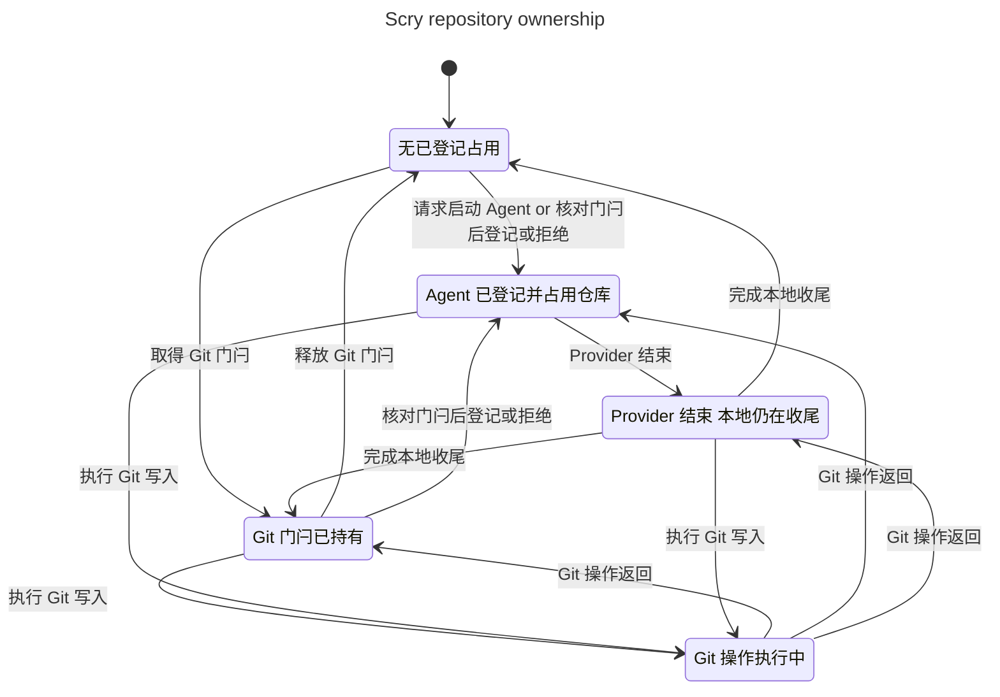
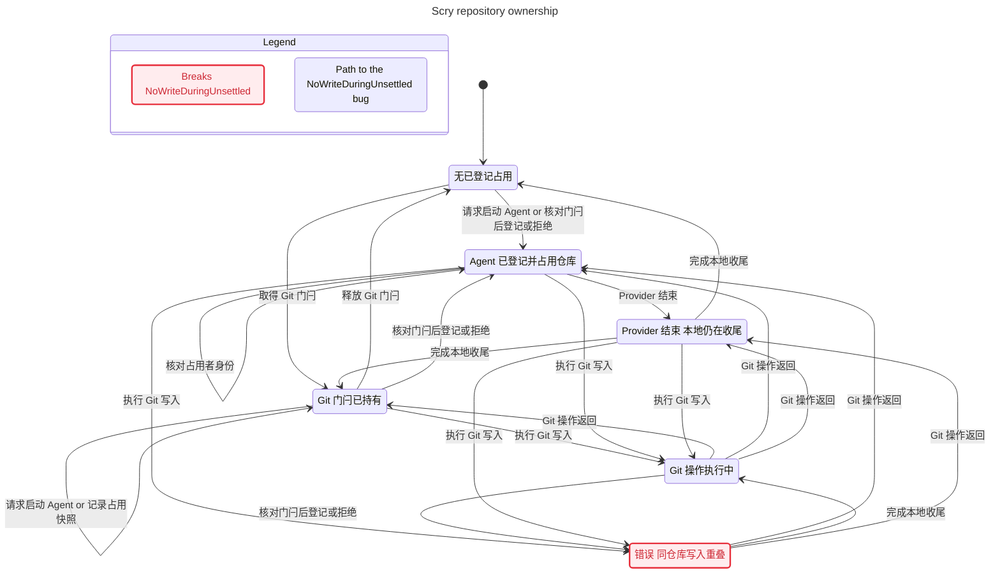
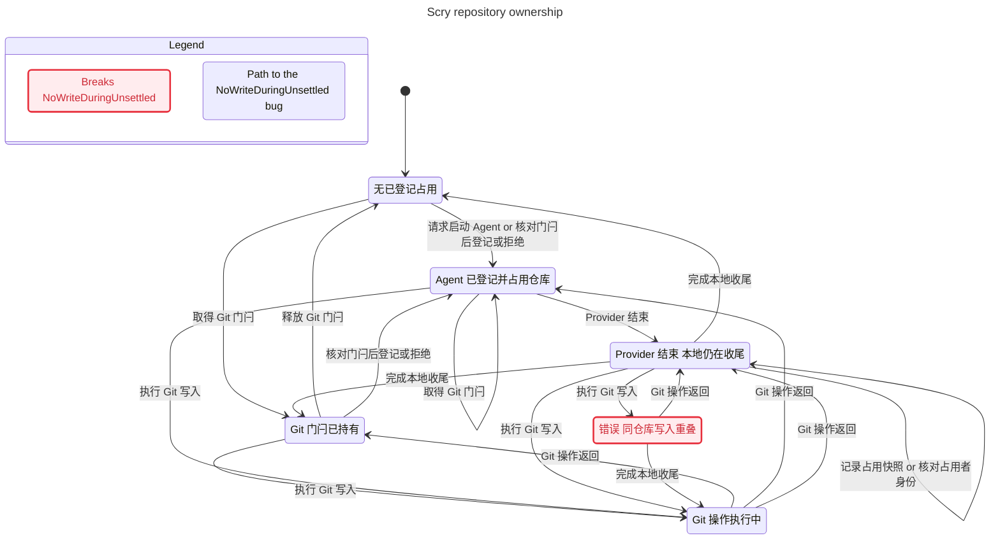

# Results and counterexamples

## Current code

At sync commit `efc650597ae694fcd83f9346c7a8bd1725176512`, TLC checked **432 reachable states** with no violation of `NoWriteDuringUnsettled`. The real-code baseline and restored copy each passed **11/11** witnesses on macOS arm64, Node 24.18.0, Java 26.0.1. Linux execution was not performed. No current-code defect was established within this scope.

The accepted cached-tool run recorded 23.16 seconds of cumulative child-command time on this host; load was not characterized. This is not a performance guarantee or total wall time. First download, machine load and platform affect the run.

The two failures below are **deliberately broken scratch copies**, not bugs reported in the current product. The checker restores those copies and leaves production files unchanged.

## Removed admission guard

Broken real code: remove the final `active.has(identity.commonDir)` rejection in `SourceControlService.admitRun`.

Harm: a newly registered Agent can overlap a panel Git mutation in the same repository.

Shortest path (six transitions):
1. `exclusive` acquires the repository gate.
2. `admitRun` starts and waits for Git identity.
3. `busy` captures an empty unsettled-directory snapshot.
4. Identity resolves; the missing guard lets `register()` run.
5. `busy` finishes checking its previously captured empty snapshot.
6. `executeMutation` dispatches while the registered run is unsettled.

The real-code test **replays shortest BrokenAdmission path** reproduces this ordering using controlled dependency promises. The unmodified guard rejects registration instead. The broader same-root and linked-worktree witnesses also fail on this mutation.

## Removed local-finalization ownership

Broken real code: remove `|| state.localFinalizing === true` from `RunRegistry.unsettledStates`.

Harm: Git writes may start while recorder/diff work still owns the repository, even though Provider transport has ended.

Shortest path (six transitions):
1. `admitRun` registers a running Agent.
2. `exclusive` acquires the repository gate.
3. Provider settles, but `localFinalizing` remains true.
4. The broken `unsettledStates` drops that run from the snapshot.
5. `busy` sees no owner.
6. `executeMutation` dispatches before local finalization ends.

The real-code test **replays shortest BrokenFinalization path** changes those real registry fields after gate acquisition, before the snapshot. It must fail with the property assertion on the mutated source and pass on the restored source.

## Reading the charts

These are the Mermaid outputs from `/statechart`, not hand-drawn proof claims. Labels intentionally combine identity waits, preflight steps and release bookkeeping. The reports retain all six numbered counterexample steps even when several share a chart label. No transition is filtered out; transitions remaining in one projected state are normally omitted except when needed for a bug path.

**An arrow from Agent occupancy to Git execution in a passing chart is possible for a different repository.** The projection does not show repository identity. It never means same-repository overlap is allowed. Every state marked as breaking the property is separated from safe states.

TLC also reports no deadlock for this finite model, which explicitly stutters at completed states. That is not a product liveness/fairness or crash-recovery claim.

### Passing baseline

TLC reached 432 states and 987 steps. The chart draws 5 states and 13 arrows.
The chart does not draw 621 steps that stay in one chart state.

### Broken admission control

TLC reached 460 states and 1101 steps. The chart draws 6 states and 21 arrows.
The chart does not draw 668 steps that stay in one chart state.

### Broken finalization control

TLC reached 448 states and 1031 steps. The chart draws 6 states and 18 arrows.
The chart does not draw 638 steps that stay in one chart state.

