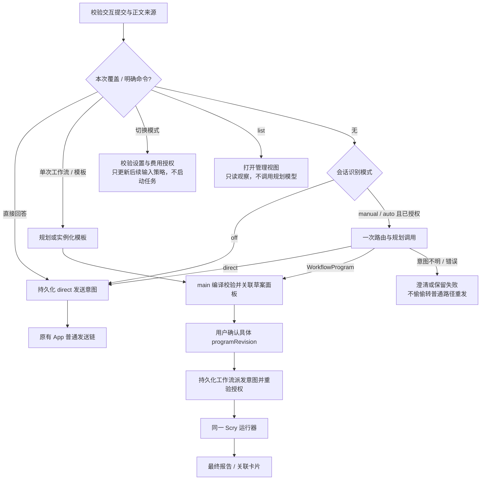

# Scry Workflow v6：聊天入口与运行模式

状态：**待实现的产品与执行合同，不是当前 App 已支持**。本规范补齐用户截图中的三种使用方式，接入已有 [运行器方案](implementation-plan.md) 与 [执行语义](execution-semantics.md)，不另造调度器。v7 的 [运行约束](runtime-limits.md) 进一步限制执行：启动后不再补业务输入，阶段人工确认拆为新运行；共享并发/单批/根预算同时生效。[v8 运行管理](run-management.md) 补充管理视图、依赖恢复、后台/退出与受控停滞重启。

## 1. 截图能力如何对应

| 用户需求 | Scry 入口与效果 |
| --- | --- |
| 用自然语言请求工作流 | 启用聊天识别后，说“用工作流审计这个目录”即可生成本次计划；无需先打开独立工作流页面 |
| 仅当前任务采用工作流 | 单次请求、输入框的本次工作流选项或 `/scry-workflow run <目标>` 只作用于当前 submission，不改变会话模式或 Provider effort |
| 让模型自行决定 | 开启会话自动模式后，编排模型判断每个新的用户任务是否适合工作流；常规问答可直接回答 |
| 运行内置或保存的工作流 | 模板选择器或 `/scry-workflow template <templateId> <参数>`；研究快捷入口为 `/scry-workflow research <问题>` |
| 成功后保存复用 | 保存为 App-owned、版本化模板；登记 templateId、参数合同和名称，下次重新校验能力与授权 |

这些是 **Scry 命令与模式**。不劫持 Claude 的 `ultracode`、`/effort ultracode` 或 `/deep-research`，不改变原生 effort、模型或权限。Scry 的 research 模板提供对应的研究流程，但不是执行 Claude 的同名内置命令。

## 2. 模式、单次覆盖与费用

模式存储在 Scry conversation 上，而非全局 Provider 配置或某个模型名称上。

| 模式 | 新用户消息的处理 |
| --- | --- |
| off（识别关闭，初始默认） | 不增加意图识别调用；普通消息沿原路径发送。显式 Scry 命令或本次工作流选项仍可发起单次任务 |
| manual（仅响应明确请求） | 识别自然语言中的明确工作流请求；没有此请求的消息走普通路径，不主动将复杂任务升级成工作流 |
| auto（自动判断） | 模型判定 direct / workflow / needs_clarification；审计、研究、改动与复验等实质任务采用工作流，小任务可单节点；寒暄和简单解释可 direct，不能因不值得拆多个 Agent 就绕过工作流 |

- **自然语言识别不是免费正则匹配**。manual/auto 使用用户选择的编排 Provider/profile/model，在新的人类任务进入时执行路由。首次启用前展示数据发送范围与额外调用费用，并取得明确授权；未配置时保持 off，不给普通聊天暗加模型请求。
- 路由与规划合成一次调用：返回 `direct`、`needs_clarification` 或 WorkflowProgram 草案；草案通过 main 校验才成为有效计划，workflow 路径不再重复调用另一个模型生成同一计划。direct 路径还会有正常聊天调用，因此可能比关闭识别多一次费用。费用未知不显示为 0。
- 路由只收当前任务和获准的必要上下文摘要/引用，不能默认把整份 transcript、附件或仓库发送给另一账号。上下文不足时澄清，不用猜测的目标启动。
- 用户可在发送前选择“本次直接回答”或“本次工作流”；它们覆盖会话模式并跳过无用路由。自动模式下同样可以单次直接回答。覆盖消费后清除，失败/取消/完成都不把它变成会话开关。
- 单次工作流在 off/manual 中完成后仍是原模式；在 auto 中完成后仍是 auto。不会更改当前 Provider 的原生 effort，也不要求切换到 Claude。
- 这里只明确初始默认 off 与会话设置，不添加全局“所有新会话默认自动”偏好。截图要求的单任务和当前会话能力不依赖该额外配置。

**已知差异**：off 下不能识别任意自然语言意图；此时使用显式入口，或先授权启用 manual。不能一边承诺任意措辞识别，一边只靠几个关键词，却宣称没有额外模型调用。

## 3. 命令与来源，不能靠字符串绕过权限

所有命令属于同一个 Scry 命名空间；它们是 App 解析的数据，不是要发给 Provider 执行的 shell/原生命令。

| 命令 | 语义 |
| --- | --- |
| `/scry-workflow list` | 打开 Scry 工作流管理视图，不劫持 Provider 的 `/workflows` |
| `/scry-workflow run <目标>` | 单次生成工作流计划；目标可为自然语言 |
| `/scry-workflow direct <消息>` | 本次跳过路由，直接按普通聊天处理 |
| `/scry-workflow mode off` / `manual` / `auto` | 请求改变当前会话的后续输入模式；首次启用或配置变更仍展示费用/数据授权 |
| `/scry-workflow research <问题>` | 绑定内置研究模板；检查真实搜索/读取能力；缺能力显示 unavailable |
| `/scry-workflow template <templateId> <参数>` | 调用指定模板；参数由模板 schema 解析/校验，不按 shell argv 执行 |

- 仅从已校验的交互提交入口接收新用户任务。origin 由 main 根据入口与消息来源赋予，不信任 renderer 自报 `human=true`；这是 App 来源事实，不承诺证明物理键盘作者。
- 工具输出、网页/附件、粘贴内容中明确标出的引用、模型结果、历史重放、自动恢复、定时任务和 webhook 都不能自动升级为用户工作流指令。路由输入保留正文/引用/附件来源边界；意图不明时澄清，不能把“解释这个命令”“不要用工作流”当启动请求。
- 显式命令只在顶层用户正文的命令位置解析；代码块、引用和普通句子里的同名文本不是命令。命令草稿在发送前显示 Scry 来源与本次作用范围，用户可撤销为普通文本。
- 补全菜单将 Scry 项与 Provider/Skill 项分组，以 typed source + ID 选择，不只靠显示名称。若 Provider 恰有同名命令，纯文本输入必须要求消歧，不静默抢占，也不双发。
- 选了 Provider 来源的命令时保持原处理路径，不先进行 Scry 自动路由；选了 Scry 来源时只交 Scry。Scry 的 `direct` 不承诺禁止 Provider 自己的原生能力，它只是不经过 Scry 工作流编排。
- 参数不全时显示待补字段，不先运行 Agent。模板保存不启动任务；重命名不改变 ID；重复显示名不可任取一个；发送时冻结实际解析出的模板版本和内容指纹。
- 当前合同覆盖桌面交互入口。远程端须具备声明过的同等 typed submission/模式控制能力才能开放；不能把现有 remote 转发请求自动标成桌面用户操作。

## 4. 自动判断不等于自动授权

保留 v5 的两层授权，不引入新的免审批开关：

1. **规划授权**：显式单次提交授权当前任务的规划；开启 manual/auto 时，用户明确授权后续新提交的路由及符合模式的规划调用。切换模式本身不处理旧消息，也不立即派发任务。
2. **执行授权**：生成有效计划后显示计划、模型、范围、循环策略及预计调用结构，用户确认该 programRevision 才派发。自动模式能自动判断和规划，但不替用户批准执行。

自然语言、命令、模板与页面按钮最终产生同一种 StartIntent 和 commandId 收据。角色模型、workspace authority、Provider 原生审批、仓库 trust/fingerprint、写入/应用策略均按原合同重验。路由模型和 Jev 都不是权限裁决者。

这里有意不同于 Claude ultracode 的部分默认放行行为。用户本次要求补齐入口，不视为授权改变原有执行/权限合同；若未来需要范围内免逐次确认，必须单独明确授权合同，不能把“自动判断”偷偷实现成“自动批准”。

一次任务需要先理解、再修改、再复验且不需中途人工决策时，优先生成一个含多个阶段的程序；需人工确认则按 v7 拆成独立工作流，前一运行结束后才接受下一阶段输入。确需多个 workflow 时，计划须显式声明组合关系、各自 ID、输入引用与完成条件；父 submission 聚合它们，不能因为首个完成就宣称整个任务完成。已确认且无需中途人工决策的组合可按依赖启动，所有自动子工作流共享根执行的 1000 次预算。需要人工决策的下一阶段只能由用户新发起，不能自动链接以绕过确认或预算；运行中未声明的新要求不能注入旧程序。

## 5. 身份、并发、切换与恢复

新增的只是一层入口事实，不是第二套 session 或 scheduler：

- `ConversationWorkflowPolicy`：conversationId、policyRevision、mode、冻结的编排角色绑定、费用/数据授权引用及有效状态。
- `TaskSubmission`：submissionId、commandId、conversationId、原始用户目标/来源、policyRevision、单次覆盖、workspace 与配置指纹、模板引用、route outcome、workflowIds 或 directRunId。
- 路由返回并不等于已发送。先记录 route outcome 和发送/启动意图，再进入既有 App 链。一个 submission 只能选择一条 direct 或 workflow 路径；双击、重挂和重复 receipt 不能同时启动两条。
- 路由失败、无效输出或外部结果未知时，不自动退回普通模型再发一遍。用户显式选择直接发送会建立新的可追踪决定；原调用未确认收敛时不能重叠发出业务执行。
- 运行中的新聊天消息不注入已有工作流；指向旧运行的新业务要求作为后续独立任务。每次发送冻结当时的模式。模式变更只作用于后续提交，不取消已有 workflow；用户要停止已有工作流须用独立停止操作。退出 auto 不等于撤销已批准计划；界面仍显示正在运行的任务。
- 用户修改 Provider/profile/model、workspace、数据范围或恢复到不兼容 runtime，相关授权失效并进入 needs_confirmation；旧运行保留自身快照。待规划任务的陈旧配置不能用于派发，须重新校验/确认。
- 模式与授权状态可持久恢复，但重启只恢复观察，不重放旧用户消息、不自动重做未知路由或派发。新建会话默认为 off；fork 不继承原会话的费用/数据授权，须重新选择识别模式。v8 可从管理页明确打开原运行，但不能按名称自动绑定或制造第二个 owner；找不到恢复记录须报错，不自动新跑。
- 同一会话可关联多个工作流，不加“只能有一个工作流”的限制。不同 submission 的配置/结果不能串线；多个工作流共享宿主 Agent 槽位池，不是每个各拿 16 个。普通 Provider session 的实际发送 fencing 仍生效；多个工作流不能并发往同一父会话注入结果。
- 结果优先进入关联卡片；安全回注受 Provider capability 和父会话空闲/顺序约束，按 submission 定位和去重。没有回注能力就保留卡片，不伪造原生 assistant turn。
- 工作流内部 Agent 输入不再经过这层聊天路由，防止自动模式递归套工作流。需要的子任务由 WorkflowProgram 明确表达，沿同一运行器执行。

## 6. 接入位置与可证伪验收

读取基线 `5dfc1f4`，存在并行 WIP。`ChatView.tsx` 已有 SlashCmd 菜单与 onPickSlash 回调，这只证明现有展示接缝，不证明支持 Scry 来源或上述命令。实施前跟踪真实发送入口；入口决策必须在 main 验证与收据层落地，不能只在 JSX 文本判断后直接调用 Provider。

| 场景 | 必须证明 |
| --- | --- |
| 单次作用范围 | off/manual/auto 各自发一次 workflow 后模式不变；成功、失败、取消均不遗留覆盖；原生 effort 不变 |
| 自然语言 | manual 下明确请求生成计划，普通复杂任务仍 direct；否定、引用、解释命令、附件注入不启动；不确定就澄清 |
| 自动模式 | 审计/改动/复验得到程序，单节点任务不被误降为 direct；简单问答走 direct；真实记录路由模型/结果/费用；开关不自动消费旧消息 |
| 识别费用 | off/显式覆盖无多余路由；首次 manual/auto 授权前不调用模型；workflow 合并路由/规划，不能重复收费却只记录一项 |
| 模板命令 | 内置与保存模板同链；缺参数/缺搜索能力拒绝；重名消歧；模板内容变化不能沿用旧确认 |
| 来源隔离 | 实际 trusted handler 拒绝伪造来源/未授权目录；Provider 命令不被劫持；工作流 worker 不能再触发聊天路由 |
| 幂等与恢复 | 双击只得到一个 submission；在 route/dispatch 每个持久化边界中断，不能双发 direct 与 workflow；unknown 不重发 |
| 授权 | auto 产生草案后未确认绝不启动；过期 policy/programRevision 拒绝；切换模型/目录后重新确认 |
| 关联与组合 | 同会话多个运行不串线且共享槽位；自动组合共享预算，人工决策必须等前运行结束再显式启动；父会话忙时不交叉注入 |
| 模式持久化 | 退出 auto 不误停已有工作；重启不重放；新会话/fork 不继承费用授权；不支持的远程入口明确 unavailable |

以上是待实现验收，按 M2 交付入口/合同、M3 接入持久执行、M5 完成真实交互、M6 做授权 Provider 验收。真实模型尚未调用，自然语言识别准确率与跨 Provider 行为尚未验证。
