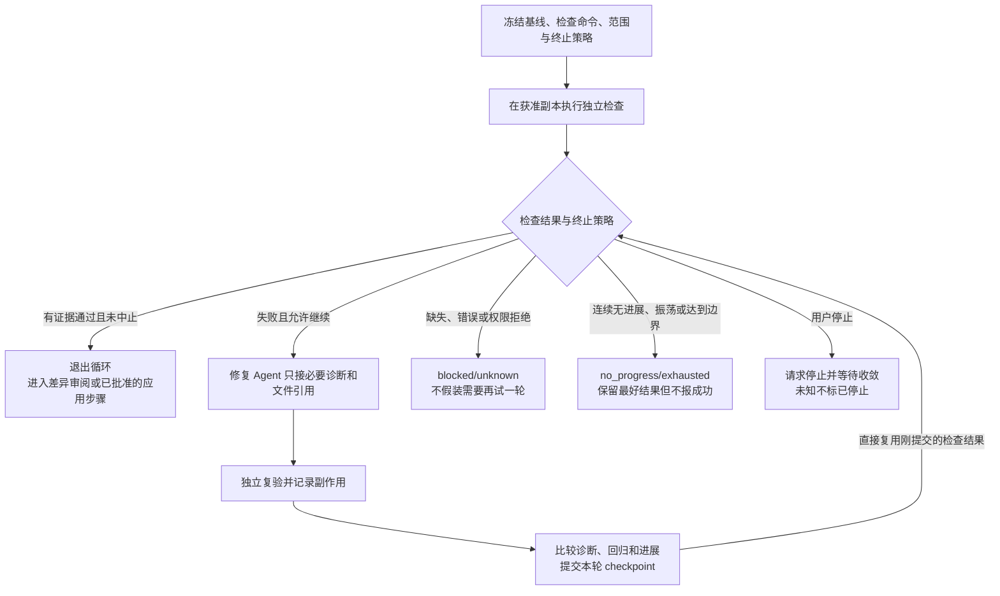
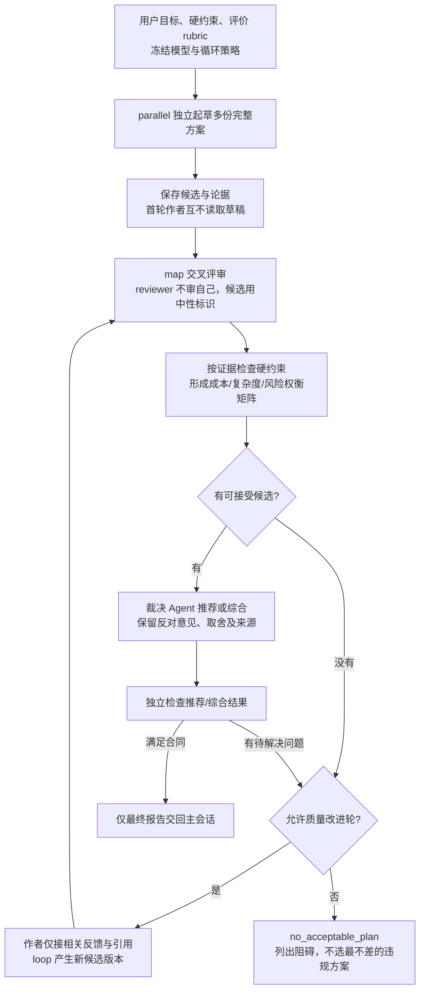

# Scry Workflow v5：执行语义与质量模式

本文是 [主技术方案](implementation-plan.md) 的规范补充，覆盖用户截图中的循环、分支、中间状态、对抗复核和多角度方案权衡。**这些都纳入本次目标能力，不再作为“以后再做”的缺项。当前仍是方案，尚无生产运行器实现。**

v7 新增的 [运行输入与资源限额](runtime-limits.md) 优先适用：默认并发≤16（可配1–256）、单批≤4096、每次根执行≤1000 Agent 尝试；运行中不接受业务输入。[v8 运行管理](run-management.md) 增加受条件约束的停滞自动重启与手动控制；用户明确选择按依赖恢复，仍禁止未知结果重发。

## 1. 研究结论与实现选择

| 来源 / 实际阅读范围 | 可确认事实 | 采用方式 |
| --- | --- | --- |
| [Claude Workflows](https://code.claude.com/docs/en/workflows)，上一轮全文 506 行；本轮重取 SHA-256 相同 | 脚本承载循环/分支/结果；独立对抗复核与多角度规划是质量模式；示例含检查修复直到通过或连续两轮无进展 | 不再把有限 DAG/map 当成全部 Workflow；补完整控制流与质量模式 |
| [Agent SDK TypeScript](https://code.claude.com/docs/en/agent-sdk/typescript#workflow)，定向读取 WorkflowInput / WorkflowOutput | 输入含 script/scriptPath/name/args/resumeFromRunId；输出含 status/taskId/runId/scriptPath/error。立即返回的是受理结果，最终结果另以 task completion 到达；有 error 时即使 status=async_launched 也未启动 | 编译、受理、实际运行、最终完成分开；不能看到 launched 就计成功。这不是 Scry 接入原生工具的理由 |
| [LangGraph Workflows and agents](https://docs.langchain.com/oss/javascript/langgraph/workflows-agents)，Parallelization、Routing、Orchestrator-worker、Evaluator-optimizer 小节 | 独立并行与同任务多样本不同；动态 worker 以独立状态接输入；评价反馈驱动再次生成 | 明确动态展开、独立候选、评价器与改进器；只参考模式，不引入 LangGraph 依赖 |
| [LangGraph Checkpointers](https://docs.langchain.com/oss/javascript/langgraph/checkpointers)，Checkpoints、Replay、Durability modes 小节 | 保存中间 task 写入可避免成功 sibling 重跑；从旧 checkpoint replay 会重新发出后续 LLM/API；持久化先后顺序影响恢复保证 | 单任务/控制帧 checkpoint；区分恢复观测与重跑，副作用未知不重放；“先持久化”采用异步 I/O 后等待完成，不是阻塞 main 的同步 I/O |

文档给出了模式，但没有提供跨 Provider 的 Scry 身份、权限与安全恢复合同。下文这些细节是 **Scry 的设计决定**，不是声称原文已经保证。

### 程序表示：不是“静态图加动画”

模型生成 **WorkflowProgram**，一种可序列化、可校验的结构化程序（IR），由 Scry 解释执行；它具有控制流、变量绑定、循环帧和返回值，不再仅是静态节点清单。左侧显示它生成的可读代码视图，中间显示正在展开的实例图，两者同源。

选择结构化程序而非执行任意生成 JS，是实现机制差异，不再以此删除循环或分支能力。它不声称支持全部 JavaScript 语言。计划需要不支持的操作时明确编译失败，不能靠退回主模型逐轮指挥来假装执行了程序。

程序没有直接文件、命令、网络、eval/import、时钟/随机值或任意宿主函数访问。模型工作由获准的 Agent/Jev 执行；副本准备、组合、应用和清理由编译器按已批准的写入策略展开成封闭的 main 系统步骤，不接受任意命令/路径。每个系统步骤也有独立 effect identity、权限重验和 checkpoint，不能隐式跳过记录。时间、随机种子、范围和身份若必要，作为冻结参数或持久控制事件输入。

## 2. 最小且足够的控制语义

只有 `call` 会调用外部模型服务；其 target 是 Agent 或 classifier。其余都是运行器纯控制/数据操作，不额外问主模型“下一步干什么”。不创建可加载插件注册表。

| 指令 | 精确定义 | 空、错误和取消语义 |
| --- | --- | --- |
| sequence | 顺序执行子块；后块只读前块已提交的绑定 | 失败依默认 fail_closed 阻止依赖块；显式 collect-outcomes 才能读取失败摘要 |
| parallel | 校验≤4096项后登记独立子块，按共享槽位/总预算派发，显式 join 后得到按稳定分支 ID 组织的 outcome | 默认 all_settled，不丢失败槽位；fail_fast 若选用须发停止请求并等待实际收敛，不把请求当取消完成 |
| map | 对已校验集合逐项执行一个子程序，可在其中扫描、分类、复核 | 每项稳定 key；结果保留每个 outcome。先校验逻辑集合≤4096，再按槽位/预算派发；分页不额外等待整页结束。空集合只有在来源真实成功且封口后才算合法空结果 |
| branch | 计算 typed 条件；只激活所选块，并记录条件输入、判定和选择 | 条件是 true/false/unknown；缺证据不能变 false。必须有 unknown 分支或显式 blocked；未选块标 skipped_by_condition，不是假成功或失败 |
| loop | 执行具名循环体，以已提交的 loopState 和本轮 outcome 计算下一步 | 必须声明成功、无进展、错误、停止策略；不因条件不明进入下一轮。停止后保留最后已提交状态 |
| call | 使用冻结角色绑定发起一个 Agent/Jev 任务，输出按合同写入独立槽位 | 同一逻辑调用可有显式 attempt；原生 session/工具审批、未知状态和归档要求不变 |
| return | 产生最终报告引用并结束程序求值；运行的 settled 仍须核对已登记作用域收敛 | 不把未执行完或关键证据缺失标 success；可返回 partial/blocked/no_acceptable_plan，但未知存活调用继续登记和观测 |

`phase` 是上述块的展示标签，不制造额外全局 barrier。一个 map item 内的 verify 可以在别的 item 仍 scan 时运行，除非程序显式要求 join。

### 表达式与中间变量

- 值域只含 JSON 值、typed outcome 和受控 artifact reference。允许 literal/ref/field、比较、布尔组合、count、concat、稳定 key 的 group/unique，以及显式条件的 filter/partition。输出较大时返回集合引用，不把内容复制进每个控制帧。
- 不允许 arbitrary JavaScript 表达式、回调或从字符串解析“命令”。解释器对版本化的有限指令/表达式集合穷尽处理。
- filter/partition 必须留下所有分区及原因；不能用 truthy/null 过滤丢失 failed/unverified。unique 合并只保留为带 derivedFrom 的聚合，不删除不同证据或反例。
- 块内单次绑定不原地覆盖；循环通过显式 carry 从 state[r] 产生 state[r+1]。只有循环控制器能提交新状态。并行子任务写自己的槽位，join 使用声明的合并规则；重复 key/不兼容写入失败，禁止 last-writer-wins。
- branch 的汇合输出是带 arm 标签的联合结果；不能读取未选分支才会产生的变量。所有输入在编译时检查作用域/类型，运行时继续验证实际 outcome。
- 静态图不能有任意回边；只有 loop 块形成受控重复。运行器使用显式控制栈和迭代帧，不递归 eval 用户代码。结构/单批载荷防护不静默截断任务；v7 的共享并发、单批和根执行预算是另外显式执行的硬约束。

## 3. 循环：迭代不是 transport 重试

逻辑轮次 `iteration` 表示用新状态和反馈执行下一轮；`attempt` 表示同一轮一次已知失败调用的显式重试，或满足 v8 停滞恢复条件的新尝试。两者身份、成本和副作用都分开。模型沉默或回执缺失不能被解释为“需要改进，再来一轮”：v8 只能在可信阶段检测、旧作用域收敛、可重放性/授权和额度均满足时重启 attempt，而不是推进 loop iteration。

### 每个 loop 必须给出

1. 初始状态与固定评价合同：目标、输入基线、验证标准/评分 rubric、已有最佳结果。
2. 循环体：生成/修改、独立检查、收集完整 outcome。
3. 终止判定：成功、已知错误、unknown、无进展/振荡、用户停止，以及可选的可见轮数或时限。
4. carry：下轮具体可以读取的诊断、必要引用、最佳候选与计数；不自动接续上一轮作者完整对话。

| 情形 | 下一步 / 最终状态 |
| --- | --- |
| 所需检查真实通过且证据完整 | 成功退出；修改类任务还不能据此声称已合入 |
| 检查仍失败，且尚未命中任何终止条件 | 提交本轮状态，运行下一轮；首次无进展可继续，不提前当连续两轮 |
| 连续两轮无进展，或状态/诊断重复形成振荡 | `no_progress` 退出，保留最好候选、失败诊断和全部轮次；不写成功 |
| API/权限/输出合同/必需归档失败 | failed/blocked；unknown 留待核对，不自动进入下一轮 |
| 用户停止或显式轮数/时限到达 | cancelled/exhausted；终态须等当前已派发调用收敛，未知仍保留 |

### 进展怎么计算

- 类型检查/测试修复：固定命令、环境、输入快照与测试范围；以规范化诊断集合、必需检查结果和回归集合比较。仅改文件、少输出日志或删测试不算进展；新回归必须计入，不能只看错误总数。
- 持续发现：按来源和证据 key 去重后的新有效候选，不按 Agent 编的新 ID 数计数；来源不足不计“本轮没新发现”。
- 方案改进：使用事先冻结的硬约束和离散 rubric。硬约束从未知变有证据满足，或独立评价提高且无硬约束回退才算改进；作者自评分不算进展。
- 连续无进展计数从 0 开始，真实进展才清零；一次未变化只累加一次。振荡指 A→B→A 这类非相邻状态回返，不能用一次 A→A 提前代替“连续两轮”规则。轮数包含初次生成/修复，基线检查不算修复轮，transport attempt 不另算逻辑轮。
- 同时命中多个结束条件时保存全部原因；已经接受的用户停止、错误或 unknown 不能被后到的成功覆盖。检查已通过的证据仍保留，不因为整个运行中止而删除。
- 没有可靠进展比较器的循环，必须先提供用户可见的终止边界，不能编译成裸 `while true`。质量改进/开放网络研究模板默认显示三轮后停止，用户可修改；检查修复/有限代码审计可按成功或连续两轮无进展终止。轮数是逻辑结束条件，与 v7 的并发和 1000 次预算同时生效；不能用新轮次重置预算。
- 时限由 main 的有来源定时事件进入控制帧，不让程序读墙钟。它阻止新一轮并按声明策略请求在途调用停止；不能承诺所有 Provider 都会在那个毫秒前退出，也不冒充精确美元预算。
- 轮间计算超出单批资源合同要显式失败或按已定义批处理，不能卡住主进程或自动跳过验证。

### 检查 → 修复 → 再检查

下一轮是已批准程序里的执行，不要求主会话重新调度；任何新增模型/权限/目标范围或检查标准变更都必须结束旧执行、确认新 program revision 并启动新运行，不能在原运行中补业务输入。

## 4. 对抗性复核：可重复的质量程序

1. scanner 返回独立 claim、作用域、可证伪依据和引用；输出只是候选。
2. verifier 使用新会话读取必要候选与原始证据，明确任务是尝试推翻它：寻找反例、例外、调用链和反证，不是改写 scanner 的措辞。
3. 首轮验证输入不含作者对话、自信分数、Jev 概率或其他 verifier 的结论，降低锚定；这些信息仍在审计记录里。独立会话或不同模型都不能保证统计独立。
4. 验证结果为 supported/refuted/unknown，须附可定位依据、检查方法、缺失证据与来源版本。结构校验通过不等于内容可信。
5. 多 reviewer 一致且证据满足合同，才能映射 confirmed/refuted；不一致保留 disagreement，进入已声明的裁决节点。裁决只能基于证据；不能用“多数票赢”替代事实检查。
6. 裁决仍不能解决则 unverified。只有预先声明的复核/改进循环才能再取证，不临时偷偷追加 Agent 或费用。
7. 汇总保留覆盖率分母、扫描失败、未复核、过期及未解决项；完整无问题与部分扫描无发现是不同结果。

研究模板也执行同一程序：对 claim 逐项记录来源、时间、证据和反例；多个相互转载网页不能自动算独立交叉验证。

## 5. 多角度起草 → 交叉审查 → 权衡 → 改进

这不是对同一 prompt 重跑几次，然后随便选一份。模板提供默认三种互补视角（最小复杂度、性能/可扩展性、安全/兼容性），用户可以调整；每份方案都必须满足同一完整任务，而不是允许某个视角忽略安全或功能。

### 决策规则

- 每个候选保存方案、假设、证据、影响面、复杂度/成本解释和验证计划。候选版本不可覆盖；综合方案是新版本，不是“赢家已经验证”就免验。
- 先过硬约束；失败/未知项不能被高加权总分抵消。对剩余方案按冻结 rubric 记录权衡，分数是判断依据而非测量事实。缺成本数据标 unknown，不填 0。
- 交叉评审至少不包含作者自己的逻辑任务；同 Provider/模型允许但标明，不能承诺因此消除了共同偏差。保存实际 reviewer 与候选分配，不把一个模型的自我复述算两个独立投票。
- 候选展示顺序固定且与模型强弱标签无关；裁决输入包括异议和失败证据，不只给最高分摘要。并行审查矩阵的预计调用数在确认时显示，不以配置上限代替费用解释。
- 同分、硬约束未知或证据冲突无法裁决时，输出可供用户选择的 trade-off，不伪造唯一最优解。报告可以是部分结论，但不能标完全通过。
- Jev 可帮助给候选/意见打标签或确定复核优先级；不能单独裁定硬约束、赢家、修复正确性或合入授权。当前 bool/阈值合同继续保留，必要的 choice/score 合同随模板需求明确添加并测试，不把 bool 公式套在它们上。

## 6. 主会话上下文边界

`RunStateStore` 是运行器事实，不是又一个聊天上下文。它存草案、分支决策、集合、候选版本、轮次反馈、检查结果、证据引用与结束原因；大对象分页按引用读取。

- 主会话发送用户目标/范围引用并取得 workflowId；进度在关联面板，不逐条注入主模型消息历史。
- 规划 Agent 只负责生成/修订程序，不能在每个子任务结束后充当必经调度者。动态 task descriptor 由程序中的显式 Agent 节点产生后交给 map，不是隐藏的主模型回合。
- Worker 只收到本节点允许的输入引用与必要片段；verifier 不拿作者完整 transcript；改进器只拿自己的相关反馈和当前输入。选择引用仍执行 workspace/来源授权，不开放任意文件读取 IPC。
- 根 return 产生有大小合同的最终报告、coverage 和 artifact refs；除最小启动收据外，只有这个完成消息可回到原会话。超过长度时给摘要和可展开引用，不截断成“全部通过”。用户之后主动追问证据，才按需引入。
- Provider 没有安全的后台结果回注能力时，Scry 展示关联结果卡，不伪造 native assistant turn；用户显式继续时再发送必要摘要。不能承诺所有 Provider 的消息注入方式一致。
- 验收应捕获实际发送给父会话的 payload：中间结果埋入唯一标记，确认它们不出现在主模型请求中；最终摘要与必要引用例外。不能只看 UI 没显示就说没有进入上下文。

## 7. Checkpoint 与并行一致性

身份扩展为 `workflowId / programRevision / scopePath / nodeId / stableItemKey / iteration / attemptId`；scopePath 包含具名并行分支和循环帧。任务身份不取决于完成顺序；新轮次不是同一 attempt 重放。

每个控制帧保存程序位置、已提交绑定/集合引用、分支决策及其输入指纹、loopState、最佳候选、无进展计数和终止原因。外部调用仍先登记意图，后发出；输出和所需证据提交后，父控制帧才能消费。

- 单 main owner 管理一个运行的控制状态；所有控制转换基于 expected frame revision。单任务写独立记录，汇合提交父 checkpoint 前复查子 outcome 引用。
- 文件式存储没有跨文件事务：先写 immutable 输出/任务提交记录，再原子替换引用这些记录的父 checkpoint；外部派发另须已有 v7 根准入记录中的预算与意图，任务档案不单独授权派发。写到一半的未引用记录不可当成功续跑的根据；恢复核对意图与任务收据，不能因父帧没前进而重发已执行副作用。
- 一次 transition 的 ID 来自帧版本/节点实例；commit 和事件发布可以重放，但外部 dispatch 不因此重放。投影按事件/状态版本去重。
- 已完成 sibling 可从相同输入、配置和证据版本复用，不因别的分支失败重跑。loop resume 从已提交帧继续；输入不变的条件重算应得到同一分支，但已记录条件不是绕过当前权限重验的凭据。
- 源码/来源、程序、rubric、模型或依赖结果变化：受影响块及下游 stale。fork 新运行/计划版本重新执行与恢复现有观测明确区分；不覆盖历史。
- 无法确认外部调用是否执行、是否还有存活 owner 或是否已有写入时保持 unknown，等待核对/显式重试；不承诺 exactly-once。Provider 内部重试只按实际可观测证据记录，不能冒充 Scry 新轮次。

## 8. 写入与迁移也是目标能力，不再只写“未来设计”

检查修复和批量迁移模板纳入本轮方案；**本次文档修订不授权在真实工作区执行这些操作**。实际运行时用户确认写入范围、验证命令、终止策略与应用策略。

1. 默认在 App 管理的隔离工作副本执行写任务。main 为副本签发绑定原授权项目、workflow 和 canonical 目录的执行 authority；恢复时重验，不向 renderer 开放任意 cwd，也不偷偷注册为所有配对 owner 可访问的永久项目。固定 HEAD 之外还要覆盖获准的未提交/未跟踪输入；不能只 worktree checkout HEAD 就谎称等于用户当前工作区。不能静默 stash、提交或清理用户改动。
2. 保存输入清单与摘要；无法可靠重建的子模块/链接/特殊文件明确拒绝该路径，不假装复制完整。每个并行写者拥有独立副本，不靠 prompt 约定避免竞争同一文件。
3. Agent 的原生权限与仓库 trust 仍生效；worktree 是冲突隔离，不是安全沙箱，不能保证 full_access Agent 不写副本之外。
4. 每项产出独立 patch 和验证证据；主进程以确定性顺序组合到独立 integration 副本。冲突保留并阻止自动应用，不用最后写入覆盖前者。还要在组合结果上跑独立检查；单项测试通过不等于组合通过。
5. 默认返回已验证候选补丁后结束；人工差异审阅后的应用是独立获准操作/新工作流，不是原运行中等待用户输入。若启动前已经明确授权“验证后应用”，应用前仍重验目标基线/脏文件；变化则阻止，收口后另行确认新操作。
6. 应用是独立、可追踪的 main 侧 source-control 操作，不是给程序开放任意 shell。内部系统步骤由已批准策略生成，不能只写在 prompt 里要求 Agent 自行合入。root return 必须反映应用结果；冲突/未知/部分应用保留恢复证据，不把源修改当成事务性无副作用回滚。
7. 验证后应用也不等于允许 commit/push。沿项目已有明确交付授权处理，不由生成程序授予；没有相应授权时只产出补丁。
8. 所有已登记调用和工具进程确认收敛后才清理副本；未知状态保留现场并提示路径。v8 重启保留之前文件变化与全部用量，不自动回滚；副作用未知不得自动重放。取消不意味着文件自动回滚。

## 9. 全部能力必须有对应验收，不能“支持循环”只测改计数

| 场景 | 必须观察到的结果 / 负对照 |
| --- | --- |
| 顺序与并行 | 就绪任务按显式共享容量/预算派发，消费者等所需证据；超额运行、提前放行或额外隐藏整页屏障时测试失败 |
| 分支 | true/false 只派发对应块；unknown 不走 false；未选输出不可读取；改变判定后旧下游失效 |
| map | 4097项首个子项派发前拒绝；合法集合按槽位/预算跨页准入，不等整页结束；每项 outcome 可找回；空集合与失败分开 |
| 逻辑 loop | 至少两轮产出不同输入指纹与 iteration；保留状态/反馈后真实再检查，不重复一次固定结果 |
| 终止 | 首次无进展继续、两次才停止；A→B→A 振荡；成功、known error、unknown、用户停止、时限/轮数分别覆盖；无策略拒绝。刚完成的同一检查结果直接复用，不无故重复执行 |
| loop 恢复 | 每个提交边界注入崩溃；不重复已经发出的副作用，不丢最佳候选或无进展计数 |
| 对抗复核 | 注入已知伪候选/反例；只复述 scanner 或盲目多数票不能通过；失败 verifier 留 unverified |
| 多方案 | 作者输入互相隔离、reviewer 不能审自己、硬约束淘汰不被分数抵消；全不合格返回 no_acceptable_plan |
| 方案改进 | 反馈真的进入对应作者下一版；综合结果重新检查；未采纳异议及原因保留 |
| Jev | 概率、置信度、阈值和 unavailable 分开；不能直接选赢家或批准写入 |
| 上下文边界 | 捕获父会话实际请求，只出现最终报告/必要引用；中间唯一标记泄漏必须失败 |
| 并行恢复 | sibling 一失败不会重复已提交成功 sibling；状态碰撞不 last-writer-wins；未知 dispatch 不重发 |
| 写入组合 | 有脏文件/未跟踪文件的输入快照；重叠 patch 冲突；组合测试回归；基线变化拒绝应用；取消后不误删现场 |

以上是待实现的验收合同。执行时使用现有临时 workspace/userData、本地进程/Provider fixture 和实际注册 wrapper；关键保护做反例。真实 Provider/Jev/费用和外部数据发送仍须明确授权，不能拿假概率或模拟 Agent 冒充验证。
