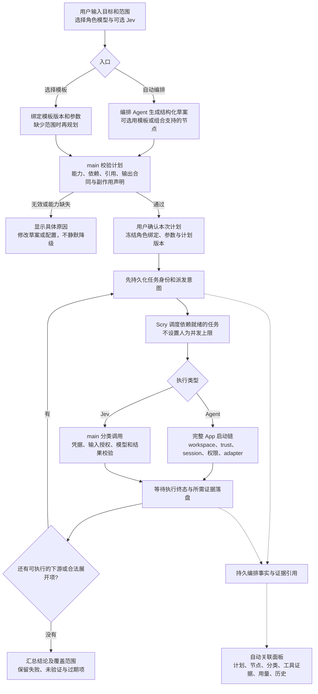
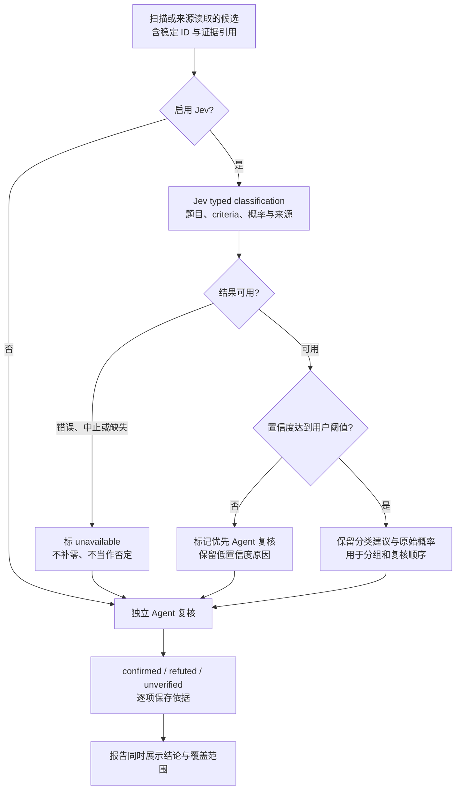
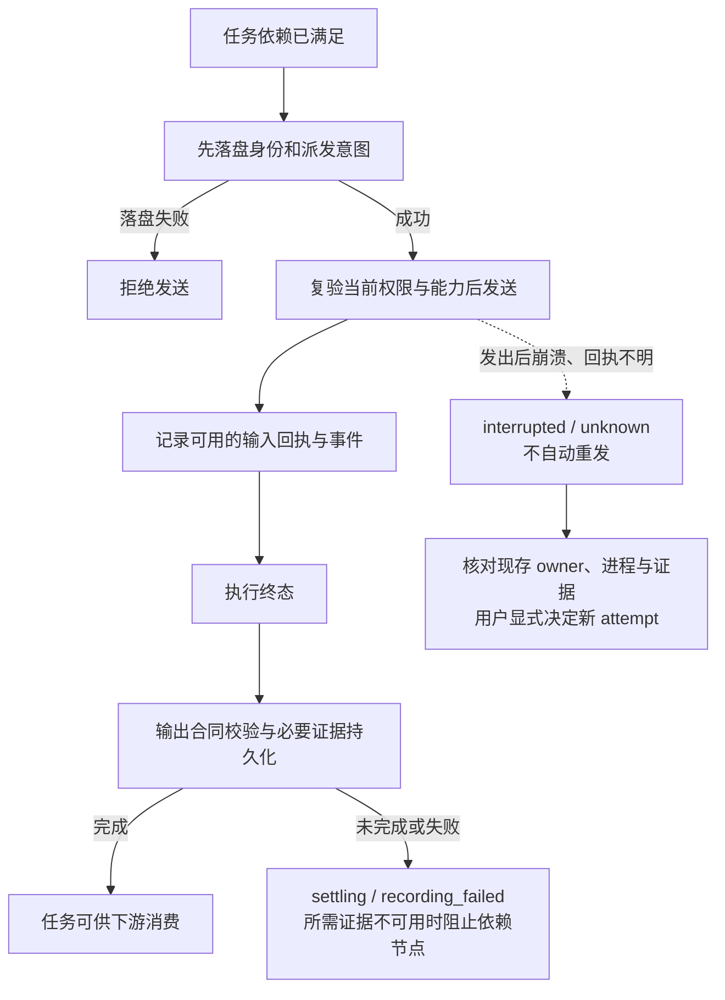

# Scry-owned 工作流：任务驱动编排 + 可复用模板

状态：**技术方案，不是已实现的生产能力**。用户已确认“按任务生成计划，模板作为捷径”，本轮据官方文章细化。HTML 原型仍是固定鉴权审计模板及可选 Jev；本轮不修改运行器或真实 Provider。

参考：[Claude 官方 Workflows](https://code.claude.com/docs/en/workflows)；逐项事实与取舍见 [原文核对](reference-notes.md)。当前基线 HEAD 为 `51452a2`，工作区含并行 remote/iOS WIP；本轮复查关键符号，不把旧行号当合同。

## 1. 已确定的产品边界

- **Scry 自有运行器**，不依赖 Claude 原生 Workflow，不执行模型生成的 JavaScript，不复制其命令系统。
- **自动编排与模板共用一条执行链**。不同任务可以有不同阶段、依赖与检查标准；小任务允许单节点，不为展示多 Agent 强行拆分。
- 用户选择编排、执行、复核、汇总角色的 Provider / 可用 profile / 模型，并可覆盖某阶段。Jev 是独立可选 classifier，不混入 coding Agent 列表。
- 不设置产品并发上限、单活动 workflow 限制或总任务数上限；不隐藏 maxWorkers。真实 Provider 准入、认证互斥、会话冲突、资源错误仍必须遵守。
- 每个 workflow 创建时即有 ID 和面板。后台执行与当前聊天焦点、renderer 生命周期分离。
- 扫描只是候选；独立复核才产生 confirmed / refuted / unverified。没有证据不能显示 0、成功或“无风险”。
- 第一批覆盖分析、审计、评审、研究类任务。自动修复/迁移/合入与循环执行单独交付；用户要求这些能力时明确尚不支持执行，不能悄悄改成审计后宣称完成。

### 左侧应显示什么

上方显示**用户选择的编排模型**；下方显示**本次冻结计划的可读投影**，不是每次都相同的 `scan/edit/verify` 脚本。

- 展示目标、模板来源或自动生成、plan revision、节点与当前执行位置。
- 生成中的计划标草案；验证通过且用户确认后才标执行计划。
- 左侧大纲和中间图来自同一个 plan snapshot；不维护两份可漂移的“脚本”和图。
- 保存为模板时保留定义与参数，不保存“上次检查了这九个文件”当成通用执行逻辑。

## 2. 总流程图

下图全部是**拟实现流程**；当前原型只演示其中的配置与运行投影。

[打开可缩放总览图（SVG）](workflow-overview.svg)。以下 Mermaid 进一步展开调度、Jev 和恢复细节；SVG 已在浏览器实际检查布局。

**两个授权时点**：用户点击“生成计划”授权在选定工作区/账号下运行规划步骤，规划本身可能消耗模型费用；不是先偷偷运行模型再询问。点击“执行计划”才放行实际任务。用户提供参数已足够时，模板可直接实例化，不额外调用规划模型。

Provider 工具审批仍走原生/映射后的权限模式。批准计划不替代仓库配置指纹校验，不改变既有 MCP/Hook/plugin 自动授权策略，也不自动升级 full_access。

确认/启动使用 commandId 幂等收据并绑定用户看过的 planRevision；旧版本确认不能启动已变化的计划。派发前仍重验当前 workspace、trust 与 capability，不能只依赖预览时的检查。

## 3. 模板不是另一套调度器

### 第一批 Scry 模板

| 模板 | 典型计划 | 必需能力与结果 |
| --- | --- | --- |
| 代码审计 | 确定范围 → 按文件/模块扫描 → 可选 Jev 分类 → 独立复核 → 报告 | 工作区读取与结构化候选；报告保留未知项 |
| 变更评审 | 固定 diff 基线 → 按风险/文件评审 → 去重但保留来源 → 复核 → 排序报告 | 可验证的 diff/工作树输入；基线变化标 stale |
| 资料调研 | 问题分解 → 多角度检索/读取 → 可选 Jev 标签 → 对照来源 → 带引用报告 | 在线调研需要实际可用的搜索/读取能力；不可用就拒绝在线计划，不偷偷假装检索过 |

这些是 Scry 拟内置模板。官方当前明确内置的只有 `/deep-research`；其余例子是生成工作流的提示词，不称为已移植的官方模板。

### 自动入口如何使用模板

1. 编排 Agent 输出目标、建议模板或新组合、节点职责、依赖、输入/输出合同与验证标准。
2. 模板是可复用的计划骨架，不是强制路线；允许省略无用阶段、增加受支持的独立检查分支。
3. main 只接受当前支持的节点与引用。遇到写入、循环、能力缺失或非法依赖，返回具体不支持项，不能用“尽力执行”绕过。
4. 用户看到计划差异与模型绑定后批准。规划模型不能偷偷选择更贵模型或改变权限。
5. 完成后可“保存为模板”：明确哪些输入变成参数、哪些依赖固定，再保存版本化定义；下次执行重新校验能力、范围和 trust。

模板存 App-owned storage。第一批不扫描并自动执行仓库内脚本、不实现导入插件，也不创建通用拖拽编辑器或模板市场。

## 4. 最小计划合同：数据，不是可执行脚本

复用现有类型/校验模式；只新增工作流自身所需的数据合同。不引入任意 JS VM、JSON 表达式引擎、通用注册表或第二套 Provider SDK。

| 记录 | 核心字段 / 语义 |
| --- | --- |
| TemplateDefinition | templateId、version、参数合同、角色、节点骨架；来源标 built-in/user |
| WorkflowPlan | workflowId、planRevision、userGoal、workspace identity、templateRef（可空）、配置快照、节点定义、证据要求 |
| PlanNode | nodeId、phase 展示分组、kind=agent/classify、roleRef、dependsOn、inputRefs、outputContract、可选 forEach |
| ExpandedTask | taskId、nodeId、stableItemKey、inputFingerprint、生成来源；map 的每项是可追踪任务，不是临时数组位置 |
| Attempt | attemptId、执行身份、派发意图/回执、状态、输出及证据引用、已知副作用、用量来源 |

`phase` 只分组展示；串行由 dependsOn 表达，独立节点天然并行。`forEach` 是对上游已校验集合的受控展开，不是脚本循环。汇总也是普通 Agent 节点，只消费结构化结果及引用，不接收全部 transcript。

### 校验规则

- 校验 schema 版本、唯一 ID、引用存在、依赖无环、输入/输出类型匹配、合法 workspace 与角色绑定。
- 输出合同使用应用支持的命名合同（文件清单、候选发现、复核结论、来源/报告），不由模型提交任意代码执行验证。能复用 adapter 原生结构输出则复用，但不能假设所有 Provider 都支持；后验校验始终需要。
- 生成 prompt 标 `source: generated_task`，保留原始用户目标，不伪装成用户直接指令。无效输出记 output_invalid；本期不静默付费重试或把错误解析为空数组。
- 为需要可靠结论的节点声明独立复核，不允许扫描者把自己的自述当 verified。独立会话不等于保证模型无共同偏差；记录 reviewer 与证据来源，不用“多数票”替代来源核对。复核冲突保留各方依据，结论标 unverified/存在争议；额外复核必须来自已批准的节点或新计划确认，不能偷偷追加费用。
- 源码引用包含授权路径、revision 与相关工作树内容摘要；网页引用包含 URL、获取时间和已保存内容引用。报告引用“当时读到的版本”，不假装可变 URL 或旧行号就是当前事实。
- 验证单条/单批 payload 上限，按页处理全部项目；超限明确报错或分批，不静默丢任务，不将分页大小变成任务总数上限。

### 运行中才知道任务数量，怎么办？

用户确认的计划可以写“对发现集合中的每项执行扫描/复核”，不必在启动前猜数量。只有上游输出已验证并落盘，才能展开。

- 将每项绑定稳定 key，登记 expansion checkpoint 后才派发；崩溃后依据 checkpoint 查已登记任务，不重新从数组下标猜身份。
- 展开不得新增未经确认的 Provider/权限/数据发送范围。越界就进入 needs_plan_approval，而不是绕过确认；原有在途任务按已有合同收敛。
- 集合还在产生时显示“已发现 N / 总数未定”，不显示假的完成百分比。真实成功返回空集合才能省略空分支；上游失败不是空集合。
- 一期只支持有限上游集合的 map，不做无限流或循环修复。后续循环必须有显式结束/无进展条件及费用、写入授权；这不是恢复并发上限的借口。

## 5. Jev：分类建议与事实验证分开

Jev 使用独立 classifier 调用路径；不是有终端、工具或写权限的 Agent，也不占用 Agent session。沿用已确认的启用/模型/阈值配置，冻结到 plan revision。

第一批 Jev **只做分类、分组与复核优先级**，不自动删掉高置信度的否定项，因此不会宣称已减少复核调用或费用。若之后需要省略低价值项，必须另行定义用户明确选择的筛除策略和 triaged_out 状态；它不等于 refuted，安全审计不能默认省略。

- 首先支持固定 bool 题型。`confidence=max(p,1-p)`；p=0.09 的置信度是 0.91，不是 0.09。choice/score 只有真正需要时再扩展，使用其真实 confidence，不能套 bool 公式。
- 分类失败只使分类证据 unavailable；若已批准的计划包含独立复核且原始输入仍可用，可以继续复核。否则显式 blocked，不临时发起未经批准的额外 Agent。
- 凭据与调用在 main。选定账号/费用和发送数据范围后才允许请求；不继承当前 Pi harness 的凭据，不把 key 放 renderer、模板、localStorage 或日志。
- 保存问题/criteria、输入引用、请求与实际模型、概率/置信度、路由原因、stopReason 和用量 provenance。Classifier 用量单列，不能与 Agent/主会话重复累加。
- 当前代码没有 TypeSafe/Jev transport。Pi 的 `models.classify` 只是参考合同，生产实现前必须核对 TypeSafe 官方 API 与仓库可复用依赖。现有原型概率仍是假数据。

## 6. 实际执行：复用完整 App 启动链

本轮阅读确认以下接缝；均为代码证据，不是新能力已通过真实 Provider 验收。

| 已有代码 / 符号 | 复用点与必须补的内容 |
| --- | --- |
| `src/main/index.ts`：AppRunStartOptions / startAppRun | 当前 origin 仅 local/remote，本地还耦合 currentCwd 等状态。补显式 workflow owner、独立 session/context；不能冒充 remote 或驱动 renderer 发消息 |
| 同文件：LiveTraceIngestion / runs.isViewed(runId) | publish 仍按可见 run 过滤。增加全 run observer，让 workflow 投影接归一化事件，不抢焦点、不只监听 onTrace |
| 同文件：archive、settleManagedConversation、runStopLifecycle.settle | 分开发出终态、归档和最终收敛；向 workflow 暴露明确 completion/recording outcome，不能只听 turnDone |
| `src/main/providers/registry.ts`：run / runControls | 复用实际 adapter 与 capability envelope；SCRY_RUN_CONTROLS=0 当前会清除 model，指定模型的 workflow 必须前置拒绝 |
| `src/main/run-registry.ts`、`provider-operation-gate.ts` | 多 run/focus:false 与认证互斥可复用；仍要独立 session fencing，不能把认证互斥当人工串行调度器 |
| `src/main/providers/types.ts`：ProviderRunHandle | 复用 interrupt、promise 与 forceKillScope；仅停止登记且身份匹配的执行，不能杀掉共享 transport 的其他任务 |
| `transcript-archive.ts`、`trace-turn-progress.ts`、`managed-turn-commit.ts` | 复用 canonical 证据与恢复事实；新增的只有编排关系与引用，不复制 transcript 或 token ledger，不把 workflow 塞进 recorder core |
| `provider-event-log.ts` | 可选、fail-open 诊断日志不能充当持久调度 journal |
| `Pickers.tsx`、`BackgroundWorkPanel.tsx`、`AgentsSurface.tsx` | 复用模型/配置档选择、停止文案与证据展示。Provider 内部子 Agent 只是观测对象，不自动重复算 Scry 调度任务 |

实现先抽取最小启动/收口接缝，不顺手重写整个 main。请求模型和观测模型分列；不支持/未登录/不可选择就拒绝或明确 unavailable，不自动替换。实际模型未被上游报告则标 unknown，不把请求值冒充观测值。若 Provider 自行替换模型，保留事实并标记合同未满足，不能悄悄沿用原名称。

工具审批和 Agent 追问沿现有 requestUserInput/权限回调，绑定 workflow/task/attempt，显示在对应运行面板而非污染当前聊天。回答只作用于仍有效的目标请求；停止后的旧问题不可恢复旧 attempt。不同 adapter 不支持交互时显式拒绝相关计划，不自动代用户回答。

### 权限事实

现有 `AgentPermissionMode` 没有跨 Provider 强制只读保证。第一批称“请求只读分析/审计”，prompt 不写文件不是安全沙箱。工具、经指纹校验的仓库配置以及 recorder 仍可能写入；保持现有授权与观测，不作更强承诺。若要保证不写源文件，需另立执行约束，而非改一句 UI 文案。

## 7. 持久化、下游准入与恢复

身份链：`workflowId → planRevision → nodeId → taskId → attemptId → providerRunId/classifierRequestId`。原生 session/turn ID 未提供就留未知，不拿生成 ID 冒充。

- **先持久身份不等于 exactly-once**：外部调用与本地落盘不能原子提交。无回执时宁可 unknown，也不能假定没执行而重发。
- 下游准入依据：执行 terminal、输出有效、节点要求的产物/归档落盘；managed recorder 开启且属于必需证据时也须收口。禁用/不支持的可选证据以明确 coverage 表达，不要求不存在的 API；必需证据失败则依赖 blocked。
- 三组状态分离：execution（pending/preparing/running/terminal）、recording（pending/committed/failed/disabled）、evidence（available/partial/unavailable/stale）。completed 不自动等于 verified。
- 失败集合保留每项 outcome。报告节点可以按显式 collect-outcomes 合同读取成功与失败的摘要，不能把失败输入当普通成功产物喂给执行节点。
- 首版采用 `userData/workflows/` 下 App-owned 文件：版本化模板、每次运行的计划/展开页、任务与 attempt 记录。主 manifest 只放运行头和引用，不塞全部任务。单个 attempt 的身份、派发意图和当前结果同记录原子更新；列表索引可重建，不把索引当执行事实。
- 现有 `scry.db` 是可降级的分析/用量账本，不选它作为必须可用的调度事实源。沿 `transcript-archive.ts` 的 owned-path / 临时文件原子替换模式实现异步写入，不直接调用其中同步写 helper 阻塞 main。此处不承诺外部调用与文件事务的 exactly-once。
- 编排历史保存阶段/任务生命周期和证据引用，不复制每个流式 token 或工具正文；工具级回放读取原有归档，并诚实标出证据缺口。renderer 只持有当前窗口；不建立第二套 transcript/费用事实源。

### 不复制 Claude 的“按启动顺序重放”

保存稳定任务身份、输入引用/摘要、工作区基线、角色/模型/权限/合同指纹。缓存复用或重试时对照这些输入和所需证据；不能只看同一个 HEAD，未提交修改和来源内容变化也要计入。

- 输入/模型/计划或依赖产物变化：相关任务与下游标 stale；无关已完成分支不会因为排队在 B 后面就自动重跑。
- 无法证明输入未变：不复用，显示原因。没有历史事实时不能装成 resume，明确新运行。
- 一期默认无自动重试。用户重试产生新 attempt，保留旧用量、文件足迹和副作用；旧进程未收敛/状态未知时不得重叠发送。
- 重启先恢复观测与核对 owner，不根据 running 字段自动拉起 Agent；更改计划先新 revision 并确认，不原地篡改运行快照。

### 暂停、停止、限流

暂停调度只阻止新任务，允许在途工作收口，不承诺跨 Provider 挂起进程。停止先登记 stop_requested，再调用已登记 handle；确认收敛后才 cancelled，未知写操作不盲目重发。

真实 rate-limit/资源拒绝按 adapter 能力显示 failed/blocked/waiting。不能从沉默猜限流；不能复制仅适用于特定 Claude 交互订阅的自动等重置策略。不得因模型无输出自动重启并覆盖先前副作用。

## 8. 面板、性能和成本

- 全流程事件驱动：计划产生、确认、展开、dispatch、工具/分类、settling、终态都更新同一个持久投影。临时断线用 snapshot + revision 修复，不靠 renderer 轮询调度。
- 图上明确预计节点与已展开任务；大图按阶段折叠，长列表分页/虚拟化。可见 IPC 批次有上限，不把全 transcript 或整张任务图反复搬给 renderer。分页展开不能等待上一页任务全部结束才派发下一页，否则会变成隐藏的并发窗口；只等待登记/准入所需事实，不等待无依赖任务的终态。
- 左侧计划、图、日志、详情引用同一身份链。点击 Agent 看 prompt/模型/工具/证据；点击 Jev 看问题/概率/阈值/分流理由。计数分别是 Agent 与分类请求。
- 用户切聊天或关闭面板不停止后台运行；停止绘制不等于停止执行。请求态、实际执行态与证据覆盖分别显示。
- 共享稳定提示前缀是文本组织优化，不承诺跨 Provider 缓存命中。本期不加首请求 5 秒等待，也不增加固定扇出槽位来“优化缓存”。
- 用量尊重 canonical 来源，包含规划/失败尝试与分类调用；未知就是未知。预估/提醒不得当硬预算；没有准确计量时不保证“花费不会超过 X”。
- 新 IPC 走 typed preload、handleTrusted、sender/schema/path 校验，并映射 performance-paths。main 用户路径不用同步 I/O；按现有性能合同测量，不为文档改动编造提速结论。

## 9. 实施顺序与可证伪验收

| 阶段 | 交付 | 必须能证明的行为 |
| --- | --- | --- |
| M1 启动与收口接缝 | workflow owner、独立 session、全 run observer、completion/recording outcome | 两个后台 run 不串聊天；真实 trusted wrapper 拒绝非法调用且不执行 listener；关闭 run controls 不静默换模型；所需证据未收口不提前放行 |
| M2 计划与模板 | 自动规划 + 三个 Scry 模板共用合同；参数、角色绑定、计划预览/确认/冻结 | 相同模板不同范围得到不同任务；审计和调研有不同图；小任务单节点合法；无效引用/环/模型/能力拒绝；生成任务不冒充用户授权 |
| M3 持久调度闭环 | 依赖图、受控 map 展开、attempt、暂停/停止、独立复核、部分结果汇总 | 不同规模就绪任务全部登记/派发，无隐藏槽位；展开崩溃不重复；落盘失败不发送；重复启动不重复执行；unknown 不重发；失败项不消失；模型/源码变化使受影响结果失效 |
| M4 分类与生产面板 | main Jev transport、凭据/数据范围、分类证据；真实事件驱动 React 面板与历史 | p=0.09 confidence=0.91；低置信度/缺失不当否定；关闭 Jev 没有请求；新配置不污染旧运行；跨聊天/重挂/重启恢复正确；窗口隐藏不影响执行 |
| M5 授权真实验收 | 单 Provider → 用户选定跨 Provider → Jev → 组合计划 | 临时 workspace/userData；明确账号/费用/数据授权；实际模型与调用证据可核对；进程收敛；不以 mock 或 HTML 回放冒充真实能力 |

UI 可在 M2 后并行按同一合同开发，但不得先用计时器动画冒充真实执行。改 main 前需协调当前 remote/iOS WIP 所有者；本轮未改这些文件。

验证复用 `run-registry.test.ts`、`provider-operation-gate.test.ts`、`command-receipts.test.ts`、`run-stop-lifecycle.test.ts`、`live-trace-ingestion.test.ts`、`trace-turn-progress.test.ts`、`managed-turn-commit.test.ts`，再补紧贴新合同的 focused tests。关键拒绝/恢复用临时工作区与负对照证明不是只检查 UI 文案；DOM/坐标/焦点走现有隔离 Electron fixture。

真正加入迁移/修复模板前，另交付 worktree 生命周期、冲突、基线重验、验证命令、差异审阅、合入授权及循环终止证据。工作副本不称为安全沙箱。

## 10. 当前完成度与下一步

- 已完成：官方文章完整核对、设计取舍、自动编排 + 模板技术方案和三张流程图。用户已确认此方向，不再次把同一决定挂为待确认。
- 未实现：生产规划器/调度器/Jev API/React 面板；HTML v3 仍是固定样例。此次没有驱动真实 Agent、读取凭据或调用分类 API。
- 下一授权动作：以此方案从 M1 开始实施，先协调 `src/main/index.ts` 的 WIP 所有权。具体真实 Provider/账号、费用及 TypeSafe 数据范围在 M5 前由用户选择，不用当前方案批准替代。
- 若后续要求强制不写入、循环修复或自动合入，由维护者明确新增合同；本方案不预留可绕过当前权限的开关。
