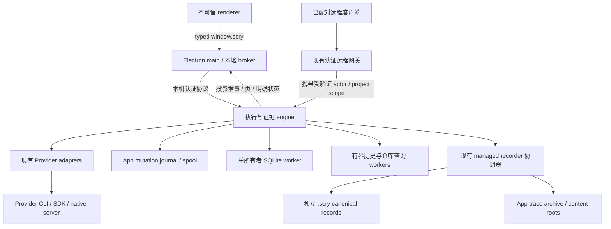

# Scry 无界面执行与证据引擎：完整技术方案

- 状态：**评审后收敛版，尚未实现；本次授权仅修订文档。建议下一实施切片为 P0＋P1，其余阶段均待证据与单独批准，不默认继续。**
- 日期：2026-10-28。
- 方案来源：多会话并发性能调查中的方案二。
- 源码基线：`66c2f38fddbc687e1a72eccc7bfe391de2971498`。
- 交付范围：技术设计、实施拆分和验收合同，不修改 App/CLI 行为，不启动真实 Provider。
- 权威边界：[仓库约定](../../CLAUDE.md)、[架构地图](../agent/architecture.md)、[性能闭环](../performance-loop.md)、[验证与交付](../agent/verification.md)。发生冲突时，本文不覆盖既有安全和证据合同。

## 阅读导航

先读本篇和首个切片，其余三篇为条件性架构附录。旧章节编号保留以便追溯评审，**不代表 P0–P7 已成为默认执行路线**。

| 文档 | 范围 |
| --- | --- |
| 本篇总览 | 当前决策、现状、阶段规模与进入条件；第 3 节为条件性远期架构 |
| [P0＋P1 首个切片](headless-execution-engine/first-slice.md) | 当前建议：归因实验、mutation 清单、内部类型草图、oracle 与止损线 |
| [附录：运行时与协议](headless-execution-engine/runtime-and-protocol.md) | 第 4–6、10 节：宿主选择条件、现有 daemon 复用与未来控制/数据协议 |
| [附录：数据与客户端](headless-execution-engine/data-and-consumers.md) | 第 7–9 节：仅在需要时启用的 journal、耐久性、DB、历史与客户端设计 |
| [附录：恢复与验收](headless-execution-engine/recovery-and-validation.md) | 第 11–15 节：条件性恢复/退出/回滚与后续验收，不是自动续做清单 |

## 0. 执行摘要与设计决策

目标不是先把 TypeScript 翻译成 Rust，而是让 Scry 的交互、执行与证据处理各有清晰所有者：

> 一次变更只识别一次；同一版本的展示投影只生成一次；正文按需读取；队列有上限；执行与界面生命周期分离；证据是否完整始终可验证。

评审后的明确选择：

1. **先测 P0，再做 P1 的单假设实验。** 保留现有进程、退出、存储、Provider 和远程 wire contract；不引入 `src/engine`、新协议或新 runtime 脚手架。
2. P0 分清 Provider/main/IPC/renderer/持久化成本。P1 针对已知全量 hash 与 mutation 识别路径，保留全量 oracle；L1 下降不是扩大重构的充分理由。
3. P2 可先纳入 raw 队列字节/等待观测。超过候选预算只报告压力；限制新准入需独立行为验收，不能截断活动 Provider 输出或谎称硬内存上限。
4. journal/spool 只有在积压证据、恢复需求和写放大估算成立后才考虑。P3 必须先完成 DB 同步调用面盘点。两者都不是 P1 的默认下一步。
5. 若确认需要进程隔离但退出语义不变，优先验证现有 worker 与 `utilityProcess`；后者不等于独立 daemon。私有 Node 运行时仅在“桌面退出后仍执行”的需求获批且现有宿主不足时重新评估。
6. 先盘点 recorder daemon 的 HTTP-over-UDS、owner 与生命周期合同。不能直接复制其旧 owner 终止策略，也不预定另起长度前缀 JSON 协议。
7. 保留既有输入收据、unknown、不静默重发及 recorder 独立性。对 Node/macOS 的耐久性按实际 libuv 路径、回退和文件系统说明，不把未做断电实验的结果写成保证。
8. 不改变日常采集字段、正式性能门禁、审批或退出策略。新增采集先限于隔离 fixture；需要修改产品策略时单独取得批准。

### 0.1 每阶段改什么、估多大、何时停止

规模为一名熟悉代码的工程师的粗估人日，含 focused 验证，不含真实账号/设备等待；不是工期承诺。P0 后更新估算。后续行只用于评估投入，不构成实施授权。

| 阶段 | 文件/调用面 | 预估规模 | 进入与止损条件 |
| --- | --- | --- | --- |
| P0 | performance fixtures/collector；run-live-state、trace-output、useAgentSession 的只读阶段观测 | 3–5 人日，约 3–6 个测量文件 | 冻结 workload 与噪声；无稳定归因或负载不可信则补测，不进入相应架构改造 |
| P1 | live-trace、run-live-state、run-execution、run-diff、trace-runtime、run-outcome、remote trace revisions 及生产写者 | 5–10 人日，约 10–15 个实现/测试文件；完整清单见首个切片 | oracle 等价＋同 workload L2 改善；三轮单假设实验仍仅 L1 下降则停止扩大，记录未证明端到端收益 |
| P2 观测 | live-trace-ingestion 与 fixture 字节/等待计数 | 1–2 人日，约 2–3 个文件 | 观测本身增加编码/内存则修正计量方式；不是丢弃阈值或全局调度器 |
| P2 持久化 | ingestion、managed commit、outbox、session deletion 与新增 journal/spool | 10–20 人日，需二次设计 | 先证明真实积压、限定故障目标并量化写放大；证据不足不做 |
| P3 | db.ts、8 个直接调用模块、transitive deletion/analytics 与 outbox 测试 | 8–15 人日；先做调用/时序清单 | DB 主线程阻塞或资源成本成立才评估；只搬进程而总成本/交互不改善则停止 |
| P4/P5 | run-execution、lifecycle、remote host、宿主和打包边界 | 待 P0 与宿主原型后估算，不报价整个重构 | 有明确隔离或独立存活需求；默认布局已满足目标则不提取宿主 |
| P6 | Overview、历史 store、冷面板、目录/历史查询 | 每个独立假设 3–8 人日，不打包全部实现 | 对应 renderer/内存/查询证据成立才进入；不以 P1 完成自动触发 |
| P7 | 对已接受切片做发布、生效映射与 L3 | 按切片计，不等待所有阶段 | 候选有 L2 与正确性证据才发布；采样不足只报告不足 |

评审处置：接受范围收敛、daemon 遗漏、私有 Node 成本、P1/DB 调用清单和写放大意见；修正“Node 不能触发 F_FULLFSYNC”与“队列硬上限收益确定”的判断。细节分别见附录 §7.2、首个切片。

## 1. 用户目标与条件性架构完成定义

### 1.1 用户目标

- 多会话同时执行时，输入、切换、停止和审批仍能及时响应。
- 打开一个会话的开销不因所有历史正文持续驻留而无限增长。
- 远程消费者不为没有变化的 trace 反复扫描和编码全文。
- 慢磁盘、巨大工具输出、长历史和大量冷会话不会产生不可见的无界积压。
- UI 可以重新连接执行状态；界面断线不等于任务完成或任务终止。
- 用户能区分 Provider 已结束、证据仍在收敛、数据库投影落后，以及操作结果未知。

### 1.2 非目标

- 不提供安全沙箱，不对同一 OS 用户下的恶意并发攻击者作新增保证。
- 不改变 `full_access`、仓库配置自动授权、指纹重验和 recorder callback 的既有策略。
- 不删除独立 recorder 副本，不削弱原始证据，不把缺失用量记为零。
- 不自动暂停、杀死或迁移任意 Provider，不统一不同 Provider 的能力语义。
- 不加入分布式调度、跨主机会话迁移、直接模型运行时或 GPUI 客户端；它们属于方案三。
- 不为了降低峰值而偷偷减少验收工作量、延迟到测量窗口外或降低证据保留要求。

### 1.3 可验收的架构目标

| 目标 | 验证口径 | 不允许的替代结论 |
| --- | --- | --- |
| 变更处理增量化 | 固定新增事件数，扩大已存历史后，事件查找和未变内容编码不随完整历史线性增加 | 仅降低刷新频率 |
| UI 工作集有界 | 固定可见窗口与驻留预算，连续加载旧页/访问冷会话后，驻留量趋于稳定 | DOM 少就宣称内存有界 |
| 持久化可控 | 记录原始积压字节、落盘队列、磁盘错误和终态 drain 时间 | 只统计已被限制的 renderer 镜像 |
| 交互与数据平面隔离 | 大轮次投影、归档、解析期间测量真实输入和停止路径 | 只证明 IPC handler 返回快 |
| Provider 输入不静默重放 | 在每个输入副作用边界注入崩溃，确认收据与实际 Provider 接受记录 | 仅检查最终数据库行数，或外推为所有 callback exactly-once |
| 总成本真实下降 | 同一有效工作量的总 CPU、总进程树内存、完成时间和响应一起比较 | worker/子进程成本不计入 |

## 2. 现状与根因证据

下表来自上述源码基线的调用链检查。它描述规模风险，不等于已证明每一项主导当前生产 CPU。此前日常采样只有一个 App 启动会话且以 Pi 为主；运行 build 与当前源码身份不同，不能据此宣称当前源码的端到端收益或回归。

| 路径 | 已有能力 | 本方案针对的剩余工作 |
| --- | --- | --- |
| [实时入库](../../src/main/live-trace-ingestion.ts) | live 和 persistence FIFO 分离 | persistence Promise 链没有明确字节/事件预算 |
| [运行中事件](../../src/main/bootstrap/run-live-state.ts)、[trace 合并](../../src/main/live-trace.ts) | bounded live projection、按同一 ID enrichment | 部分查找线性扫描；原地修改不能直接为下游提供统一 dirty revision |
| [投递桥](../../src/main/trace-output.ts)、[renderer 消费](../../src/renderer/hooks/useAgentSession.ts) | 有界镜像、批量、React commit 后 ACK、失步重同步 | IPC 完整成本未充分归因；不能把 ACK 提前到无界入队 |
| [Overview](../../src/renderer/components/OverviewPanel.tsx)、[批量合并](../../src/renderer/format.ts) | 采样、索引、clone-on-write | 全已加载历史聚合、活动轮次事件数组复制 |
| [正文窗口](../../src/renderer/components/chat-view/transcript.tsx)、[右侧面板](../../src/renderer/hooks/useSessionRightSurfaces.ts) | 部分正文虚拟化、隐藏面板 active 标识 | 每轮 shell、当前历史累积、冷 UI 驻留与执行生命周期耦合 |
| [远程 revision](../../src/main/remote/desktop-trace-delta.ts) | 已有增量传输与失步 reset | observe 仍编码/hash 全部 item；有 delta 不等于宿主增量计算 |
| [SQLite](../../src/main/db.ts)、[轮次完成](../../src/main/bootstrap/run-completion.ts) | outbox、canonical usage 合并、证据收敛 | 大轮次同步投影及部分同步查询占用 main |
| [归档](../../src/main/transcript-archive.ts)、[Pi 历史](../../src/main/pi-native-history.ts) | 索引、选页读正文、部分缓存 | 元数据成员验证、源文件指纹和部分 map 重建仍随源规模增长 |
| [目录浏览](../../src/main/workspace-files.ts) | 返回页有上限，路径授权 | 全目录 stat/授权/sort 后才分页，宽目录并发缺少预算 |
| [启动](../../src/main/bootstrap/run-execution.ts)、[身份准入](../../src/main/context-admission.ts) | session/cwd/auth/trust 排他与重验 | 不是全局 CPU/内存资源调度器 |
| [远程派发](../../src/main/remote/remote-dispatcher.ts) | durable intent、未知结果不重放 | 当前 pump 不提供全局资源容量准入 |

不重复立项：双根内容准备已在 [content-store](../../src/core/turn-recorder/content-store.ts) 复用编码/摘要；managed intent 已有小型阶段 sidecar；Codex/OpenCode 已复用 native server；Pi 已有 catalog 和精确 session 的不同复用路径。相关实验见 [性能机会日志](../performance-opportunities.md) 和 [内容副本实验](../performance-experiments/20261026-content-copies.md)。

## 3. 条件性远期架构与所有权

图为未来需求成立时的逻辑设计，不是当前部署状态，也不要求每个框成为独立进程。journal/spool、DB worker 和新宿主各有独立进入条件；P0/P1 不创建这些组件。engine 和受信任网关仍以本机用户权限工作；renderer 不因此获得该权限。

### 3.1 唯一所有者

| 状态/资源 | 唯一写入所有者 | 其他消费者 |
| --- | --- | --- |
| 活动 run、Provider transport、审批、stop 状态 | engine | broker/远程网关只发送 typed 请求 |
| 资源预留、排队收据、dispatch fence | engine 内串行控制状态机 | UI 读取明确 queue/dispatch 状态 |
| App mutation journal、raw spool、投影 revision | engine 数据平面 | worker 持有有范围的只读引用或确认过的 job |
| SQLite 连接、schema migration、outbox replay | 单一 DB worker | 所有查询通过异步有界 API，不保留 main 同步旁路 |
| managed commit 与 `.scry` 写入 | 现有 recorder 协调链，仅由 engine 发起 | DB/renderer 不修改 canonical turn |
| 后端项目、Provider、会话配置 | engine 的既有 store 投影 | main 通过 typed 操作更新，不直接写同一文件 |
| 窗口几何、临时 UI 选择、系统交互 | Electron broker | 不成为运行、权限或恢复事实源 |
| 用户草稿、脏编辑、终端生命周期 | 按既有归属迁移；终端执行不归 UI 组件 | UI 实例可卸载，不能丢弃用户内容或停止 shell |

`app-store` 中混合前后端字段先由现有单一写者提供 facade，再按字段迁移。禁止让旧 main 与新 engine 同时写同一个 store、DB 或 managed commit journal。

### 3.2 远期代码位置（仅供评估；当前切片不创建）

- `src/engine/`：不导入 Electron；run/control、journal、projection、budget、host lifecycle。
- `src/shared/engine-protocol.ts`：版本化请求/响应/事件合同及运行时校验。
- `src/main/engine-broker.ts`：受信任 renderer wrapper、OS 集成、连接与重连；不包含第二套执行状态机。
- `src/engine/workers/`：DB、history/query 入口与有界 job 合同。
- `scripts/` 中新增 engine 打包/协议/故障验证脚本，但只有实施阶段才命名、注册并运行。

复用 domain 类型、Provider registry 和 recorder，不建立第二套同义状态。先按实际调用迁移最小依赖，不预先设计通用插件框架。
