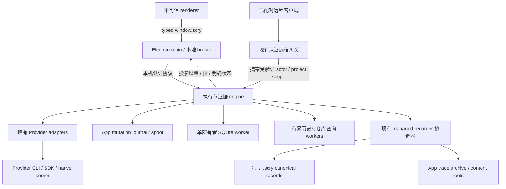

# Scry 无界面执行与证据引擎：完整技术方案

- 状态：**设计提案，尚未实现；本文不表示迁移、后台常驻、协议或性能门禁已获实施批准。**
- 日期：2026-10-28。
- 方案来源：多会话并发性能调查中的方案二。
- 源码基线：`66c2f38fddbc687e1a72eccc7bfe391de2971498`。
- 交付范围：技术设计、实施拆分和验收合同，不修改 App/CLI 行为，不启动真实 Provider。
- 权威边界：[仓库约定](../../CLAUDE.md)、[架构地图](../agent/architecture.md)、[性能闭环](../performance-loop.md)、[验证与交付](../agent/verification.md)。发生冲突时，本文不覆盖既有安全和证据合同。

## 阅读导航

本技术方案按职责拆分为四篇，组成一个完整设计；不是四个独立实施选项。章节编号跨文档连续，状态均为**尚未实现**。

| 文档 | 范围 |
| --- | --- |
| 本篇总览 | 第 0–3 节：决策、目标、现状与所有权 |
| [运行时与协议](headless-execution-engine/runtime-and-protocol.md) | 第 4–6、10 节：启动认证、控制/数据协议、Provider 与资源治理 |
| [数据与客户端](headless-execution-engine/data-and-consumers.md) | 第 7–9 节：日志、内容、删除、数据库、历史与客户端 |
| [恢复与验收](headless-execution-engine/recovery-and-validation.md) | 第 11–15 节：故障、退出、回滚、阶段、验证和决策 |

## 0. 执行摘要与设计决策

目标不是先把 TypeScript 翻译成 Rust，而是让 Scry 的交互、执行与证据处理各有清晰所有者：

> 一次变更只识别一次；同一版本的展示投影只生成一次；正文按需读取；队列有上限；执行与界面生命周期分离；证据是否完整始终可验证。

本方案的明确选择：

1. 保留 Electron renderer 和现有 Provider adapter。第一阶段不换 UI，不实现自有 Agent runtime。
2. 先在现有进程布局中建立变更版本、预算和纯业务边界，再提取无界面 engine。避免同时重写存储、协议、运行时和界面。
3. 数据库先迁到单所有者 Node worker。最终 engine 使用受签名/完整性校验的私有 Node 24 运行时，不依赖用户 PATH 的 `node`，不启用 Electron RunAsNode 降级入口。
4. 本机采用受认证的 Unix domain socket；renderer 仍只使用 typed preload。现有远程入口作为受验证的网关，不把本机 socket 暴露为任意远程命令接口。
5. 建立 App 自有、分段的 mutation journal。它服务于恢复与投影，不取代 `.scry/records`、Provider 原始 transcript 或其他不同权威性的事实源。
6. Provider 输入采用持久化收据与未知结果语义，不承诺外部副作用 exactly-once。崩溃后不自动重发可能已被接受的 prompt、steer 或审批。
7. 默认保持现有退出语义。正式的“退出桌面后继续执行”作为后续独立启用项；v1 不安装登录启动项，不默认后台常驻。
8. 不设置未经验证的性能收益承诺。性能预算首先是候选；修改采集内容、正式门禁或退出策略前，按仓库约定取得维护者批准。

## 1. 目标、非目标与完成定义

### 1.1 用户目标

- 多会话同时执行时，输入、切换、停止和审批仍能及时响应。
- 打开一个会话的开销不因所有历史正文持续驻留而无限增长。
- 远程消费者不为没有变化的 trace 反复扫描和编码全文。
- 慢磁盘、巨大工具输出、长历史和大量冷会话不会产生不可见的无界积压。
- UI 可以重新连接执行状态；界面断线不等于任务完成或任务终止。
- 用户能区分 Provider 已结束、证据仍在收敛、数据库投影落后，以及操作结果未知。

### 1.2 非目标

- 不提供安全沙箱，不对同一 OS 用户下的恶意并发攻击者作新增保证。
- 不改变 `full_access`、仓库配置自动授权、指纹重验和 recorder callback 的既有策略。
- 不删除独立 recorder 副本，不削弱原始证据，不把缺失用量记为零。
- 不自动暂停、杀死或迁移任意 Provider，不统一不同 Provider 的能力语义。
- 不加入分布式调度、跨主机会话迁移、直接模型运行时或 GPUI 客户端；它们属于方案三。
- 不为了降低峰值而偷偷减少验收工作量、延迟到测量窗口外或降低证据保留要求。

### 1.3 可验收的架构目标

| 目标 | 验证口径 | 不允许的替代结论 |
| --- | --- | --- |
| 变更处理增量化 | 固定新增事件数，扩大已存历史后，事件查找和未变内容编码不随完整历史线性增加 | 仅降低刷新频率 |
| UI 工作集有界 | 固定可见窗口与驻留预算，连续加载旧页/访问冷会话后，驻留量趋于稳定 | DOM 少就宣称内存有界 |
| 持久化可控 | 记录原始积压字节、落盘队列、磁盘错误和终态 drain 时间 | 只统计已被限制的 renderer 镜像 |
| 交互与数据平面隔离 | 大轮次投影、归档、解析期间测量真实输入和停止路径 | 只证明 IPC handler 返回快 |
| Provider 输入不静默重放 | 在每个输入副作用边界注入崩溃，确认收据与实际 Provider 接受记录 | 仅检查最终数据库行数，或外推为所有 callback exactly-once |
| 总成本真实下降 | 同一有效工作量的总 CPU、总进程树内存、完成时间和响应一起比较 | worker/子进程成本不计入 |

## 2. 现状与根因证据

下表来自上述源码基线的调用链检查。它描述规模风险，不等于已证明每一项主导当前生产 CPU。此前日常采样只有一个 App 启动会话且以 Pi 为主；运行 build 与当前源码身份不同，不能据此宣称当前源码的端到端收益或回归。

| 路径 | 已有能力 | 本方案针对的剩余工作 |
| --- | --- | --- |
| [实时入库](../../src/main/live-trace-ingestion.ts) | live 和 persistence FIFO 分离 | persistence Promise 链没有明确字节/事件预算 |
| [运行中事件](../../src/main/bootstrap/run-live-state.ts)、[trace 合并](../../src/main/live-trace.ts) | bounded live projection、按同一 ID enrichment | 部分查找线性扫描；原地修改不能直接为下游提供统一 dirty revision |
| [投递桥](../../src/main/trace-output.ts)、[renderer 消费](../../src/renderer/hooks/useAgentSession.ts) | 有界镜像、批量、React commit 后 ACK、失步重同步 | IPC 完整成本未充分归因；不能把 ACK 提前到无界入队 |
| [Overview](../../src/renderer/components/OverviewPanel.tsx)、[批量合并](../../src/renderer/format.ts) | 采样、索引、clone-on-write | 全已加载历史聚合、活动轮次事件数组复制 |
| [正文窗口](../../src/renderer/components/chat-view/transcript.tsx)、[右侧面板](../../src/renderer/hooks/useSessionRightSurfaces.ts) | 部分正文虚拟化、隐藏面板 active 标识 | 每轮 shell、当前历史累积、冷 UI 驻留与执行生命周期耦合 |
| [远程 revision](../../src/main/remote/desktop-trace-delta.ts) | 已有增量传输与失步 reset | observe 仍编码/hash 全部 item；有 delta 不等于宿主增量计算 |
| [SQLite](../../src/main/db.ts)、[轮次完成](../../src/main/bootstrap/run-completion.ts) | outbox、canonical usage 合并、证据收敛 | 大轮次同步投影及部分同步查询占用 main |
| [归档](../../src/main/transcript-archive.ts)、[Pi 历史](../../src/main/pi-native-history.ts) | 索引、选页读正文、部分缓存 | 元数据成员验证、源文件指纹和部分 map 重建仍随源规模增长 |
| [目录浏览](../../src/main/workspace-files.ts) | 返回页有上限，路径授权 | 全目录 stat/授权/sort 后才分页，宽目录并发缺少预算 |
| [启动](../../src/main/bootstrap/run-execution.ts)、[身份准入](../../src/main/context-admission.ts) | session/cwd/auth/trust 排他与重验 | 不是全局 CPU/内存资源调度器 |
| [远程派发](../../src/main/remote/remote-dispatcher.ts) | durable intent、未知结果不重放 | 当前 pump 不提供全局资源容量准入 |

不重复立项：双根内容准备已在 [content-store](../../src/core/turn-recorder/content-store.ts) 复用编码/摘要；managed intent 已有小型阶段 sidecar；Codex/OpenCode 已复用 native server；Pi 已有 catalog 和精确 session 的不同复用路径。相关实验见 [性能机会日志](../performance-opportunities.md) 和 [内容副本实验](../performance-experiments/20261026-content-copies.md)。

## 3. 目标架构与所有权

图为目标设计，不是当前部署状态。engine 和受信任网关仍以本机用户权限工作；renderer 不因此获得该权限。

### 3.1 唯一所有者

| 状态/资源 | 唯一写入所有者 | 其他消费者 |
| --- | --- | --- |
| 活动 run、Provider transport、审批、stop 状态 | engine | broker/远程网关只发送 typed 请求 |
| 资源预留、排队收据、dispatch fence | engine 内串行控制状态机 | UI 读取明确 queue/dispatch 状态 |
| App mutation journal、raw spool、投影 revision | engine 数据平面 | worker 持有有范围的只读引用或确认过的 job |
| SQLite 连接、schema migration、outbox replay | 单一 DB worker | 所有查询通过异步有界 API，不保留 main 同步旁路 |
| managed commit 与 `.scry` 写入 | 现有 recorder 协调链，仅由 engine 发起 | DB/renderer 不修改 canonical turn |
| 后端项目、Provider、会话配置 | engine 的既有 store 投影 | main 通过 typed 操作更新，不直接写同一文件 |
| 窗口几何、临时 UI 选择、系统交互 | Electron broker | 不成为运行、权限或恢复事实源 |
| 用户草稿、脏编辑、终端生命周期 | 按既有归属迁移；终端执行不归 UI 组件 | UI 实例可卸载，不能丢弃用户内容或停止 shell |

`app-store` 中混合前后端字段先由现有单一写者提供 facade，再按字段迁移。禁止让旧 main 与新 engine 同时写同一个 store、DB 或 managed commit journal。

### 3.2 代码结构（拟新增，不表示文件已经存在）

- `src/engine/`：不导入 Electron；run/control、journal、projection、budget、host lifecycle。
- `src/shared/engine-protocol.ts`：版本化请求/响应/事件合同及运行时校验。
- `src/main/engine-broker.ts`：受信任 renderer wrapper、OS 集成、连接与重连；不包含第二套执行状态机。
- `src/engine/workers/`：DB、history/query 入口与有界 job 合同。
- `scripts/` 中新增 engine 打包/协议/故障验证脚本，但只有实施阶段才命名、注册并运行。

复用 domain 类型、Provider registry 和 recorder，不建立第二套同义状态。先按实际调用迁移最小依赖，不预先设计通用插件框架。
