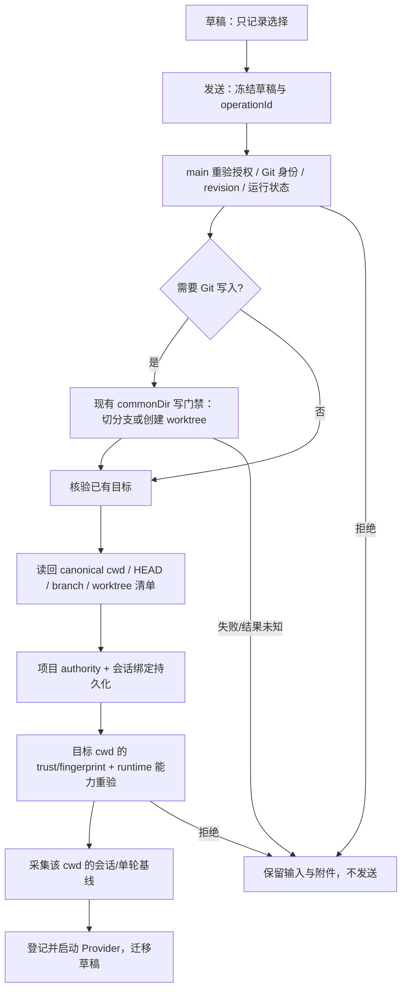

# T3 Code → Scry：新会话工作区与 Diff 设计方案

状态：**待评审，未实现 App 功能**。本轮只交付研究、设计稿和设计稿检查。

## 1. 已确认目标与建议

用户确认：工作区、会话和单轮 diff 都要；视觉融入 Scry，不整体换成 T3。

建议借鉴 T3 的**输入框上下文条 + 可展开变更摘要 + 快照比较**，不移植其服务架构。Scry 已有三类 diff 数据源；主要工作是统一入口、补齐工作区选择的真实执行链路，而不是再造 diff 引擎。

- 新会话输入框下方：左侧「当前工作区 / 新建 worktree / 已有 worktree」，右侧「分支 / 基于分支」。
- 新会话先选择，不立刻改 Git。首次发送明确执行切换或创建，成功后绑定实际 cwd，再启动 Provider。
- 右侧工作台：工作区 / 本会话 / 本轮，展示文件数、增删行、比较基准、采集时间及证据状态。
- 不承诺精确归因给 Agent：文件快照差异也可能包含用户、终端或外部程序的写入。
- 不顺带引入自动 fetch、worktree 初始化脚本、自动清理、提交、推送、PR 或历史源码持久化。

可点击设计稿：[../../designs/scry-workspace-diff/index.html](../../designs/scry-workspace-diff/index.html)。设计稿数据全部为示例；没有 Git、Provider 或磁盘写入能力。按本仓库 `.gitignore` 约定，`designs/` 是仅保留在本机的工作素材，不随提交分发；上面的本地链接在其他检出中不可用。

## 2. 调研结论

已拉取并冻结 T3 Code 提交 `d14ace8233ad3cf7856b6b834824f888240d67a1`。具体源码路径、MIT 许可、T3 与 Scry 差异和现有模块复用清单见 [源码调研](t3-workspace-diff-research.md)。结论来自定向源码阅读，未运行 T3 App 或真实 Provider。

## 3. Diff 的唯一统计合同

### 3.1 三个范围，三种基准

| 标签 | 比较 | 包含/不包含 | 展示规则 |
| --- | --- | --- | --- |
| 工作区 | 当前工作目录文件状态相对本次采集的 HEAD | 已跟踪与预算内未跟踪；受 cwd/pathspec 约束；包含会话前已有改动；不把 staged 与 unstaged 数量相加 | `HEAD → 工作区`；采集时间。提交后可能归零，不代表 Agent 没改文件。 |
| 本会话 | 首次发送前 snapshot → 当前预览/最近完成 snapshot | 期间净变化，含期间已提交变化；不包含开始前已有内容；恢复重锚仅覆盖自恢复以来 | `会话起点 → 最近完成轮次`；恢复时改成 `自恢复以来`。 |
| 本轮 | 本轮开始 snapshot → 本轮结束 snapshot | 本轮净变化；运行中仅预览 | 明确轮次、预览/已完成、证据状态。 |

例：第一轮新增 10 行，第二轮删掉这 10 行；本会话净变化为 0，不是 +10/−10。会话前已有 5 行修改，且 Agent 未碰它：工作区包含，单轮/会话不包含。

### 3.2 数字与正文

- 文件列表、汇总、正文必须指向同一个 scope 和 snapshot/revision。禁止用实时文件 patch 解释历史数字。
- 行数只统计文本；二进制显示「二进制」，仍计入文件数。空文件/纯模式变化可有文件变化但文本行数为 0。
- `captured/exact + []` 才是已证实无净改动；unavailable、failed、timeout、disabled 不得转换成 +0 −0。
- 部分证据显示「已捕获部分 +x −y」，不标全量。patch 截断与统计完整度分别说明。
- Scry 当前使用不识别重命名的部分路径，重命名可表现为删除+新增；本次不引入另一套启发式来调整总数。以后若统一 rename detection，要同时迁移各比较路径和回归 oracle。
- 保留空白变化的原始 numstat。首版不新增“忽略空白”开关，避免正文忽略空白而总数未忽略。
- 非 Git/无 HEAD 仍允许正常聊天，只是 Git diff 不可用；没有会话基线时显示「发送后开始记录」。
- 历史会话目前只保留统计，正文不持久化。**不照搬 T3 durable checkpoint**；长期保存源码正文会改变隐私、磁盘、删除和 recorder 合同，需独立批准，不是这轮迁移的前置条件。

## 4. 工作区选择合同

### 4.1 草稿意图（建议类型，不是现有 API）

```ts
type WorkspaceIntent =
  | { kind: 'current'; repositoryId: string; branchRef: string }
  | { kind: 'newWorktree'; repositoryId: string; baseRef: string; newBranch: string }
  | { kind: 'existingWorktree'; repositoryId: string; worktreeId: string }
```

非 Git 继续使用现有 cwd 草稿，不强行构造 Git intent。只允许新会话修改 intent；开始后的会话显示只读实际分支/工作区。要换目录就新建会话，不把旧 Provider resume ID 带到新 cwd。

- 当前工作区：可保留当前分支，或选择另一条本地分支；待执行状态写「发送时切换」。按钮写「切换分支并发送」，不把磁盘变化藏在普通“发送”后面。
- 新建 worktree：右侧改为「基于 main」，新分支名可编辑，默认 `scry/<短唯一标识>`。默认由宿主管理目录，例如 `userData/worktrees/<repo-id>/<worktree-id>`；renderer 只传意图，不能传任意目标路径。
- 已有 worktree：列出真实 worktree 清单、分支、缩略路径、正在使用状态；最近一项置顶。已被其他 worktree 占用的分支导向对应 worktree，不强行 checkout。
- 首版选择本地分支和已存在的远端跟踪 ref。远端 ref 只可作新 worktree 起点；当前目录模式不隐式创建 tracking branch、不自动联网 fetch。UI 写明使用本地已获取的 ref。
- 新 worktree 不复制主工作区未提交文件；在选项下明确说明。当前目录有改动仍可留在原分支发送，或创建干净 worktree；切到别的分支保守阻止，不自动 stash/reset。
- detached HEAD：当前 checkout 可聊天并显示短 SHA；新 worktree 必须显式选有效起点。unborn/非 Git 不提供创建入口。
- 名称验证使用 Git check-ref-format；ref 参数不能被当选项；NUL/换行/超长输入在 IPC 边界校验。合法文件名解析用 NUL 分隔，不按空格拆分。

### 4.2 首次发送顺序



关键边界：

1. 在现有 SourceControlService 上扩展 prepare/handoff 流程，复用 commonDir 串行锁和操作记录；不能创建与现有 mutation lock 不互通的锁，也不能在锁内再次等待同一串行队列。准备到 run 登记必须有明确的同仓库门禁交接，关闭 TOCTOU 空窗。
2. 当前同一 commonDir 有未结束 Agent 时，Git 写入被禁止。首版保留：**即使想创建另一个 worktree，也需等待这些 run 收敛**。已准备的不同 worktree 能否启动沿用既有 run/lease 合同；同一目标 cwd 忙碌时拒绝。不能用 worktree UI 暗中放宽并发安全合同。
3. 原项目 grant 不自动授权旁边任意目录。worktree 清单是候选，不是 authority。明确选择后 main 核对 worktree 与已授权 repo 的关联，canonical 目标合法，再走现有项目 authority 持久化；随后每次访问仍校验。
4. 切换/创建是 Git 执行，不只是读取。检查目标 revision 的 checkout hooks、filter/executable 等实际执行面；沿用现有 Git 受控环境和执行信任策略。必要时先禁用可执行扩展完成物化，再按 canonical 新 cwd 校验后才允许运行 Provider。不得在 trust 校验前通过 checkout 偷跑仓库配置。
5. operationId 与请求哈希绑定。重复发送不重复建目录；命令超时/断联先只读核查 `worktree list`、HEAD、branch、目标存在性。未知结果记录为 unknown，禁止自动重试写入。
6. 创建成功而 trust、持久化或 Provider 启动失败：保留已创建 worktree 和明确路径，草稿不丢；下次复用同一结果。不自动删除目录、branch，也不回滚用户可能已修改的 checkout。
7. 取消只发生在尚未 dispatch 的准备阶段；dispatch 后等待终态/核查，不把“取消 UI”当作回滚成功。
8. active 会话与 resume 的 cwd 不可被新草稿覆盖。不同 provider/profile/model 的能力重新读取；本功能只准备 cwd，不承诺 Provider 的 resume、fork 或审批等价。
9. 仅桌面本机首版。新 IPC 经 `handleTrusted` 和 preload schema；不扩大手机/远程 generic IPC allowlist。远程端若未实现该能力，保持原流程并显示 unavailable，而非绕过宿主校验。

## 5. 交互与视觉稿

**v2 按当前源码与真实 renderer fixture 校正，不以第一版原型作为视觉依据。** 模式为 Operate：让用户确定代码在哪里运行、发生了哪些变化。复用 `src/renderer/codex-alignment.css` 的中性深灰/浅色 token，而不是蓝灰面板；复用 `ChatView.tsx` 的居中终端图标与欢迎标题，以及 Composer 的 20px 圆角、顶部项目入口、左侧审批/右侧 Provider + Model 控件、圆形前景色发送按钮。保留 `Sidebar.tsx` 的新建、搜索、功能导航和项目/动态层级。

第一版误用了矩形蓝色发送按钮、简化侧栏和始终展开的 diff 列，已撤回这些设计；不修改全局 `DESIGN.md` 来迁就原型。仅给本功能补充上下文条和渐进展开的改动入口。

### 信息层级

```text
默认新会话：保留对话空间                 点击摘要后：按需展开
┌─ 原有侧栏 ─┬───────────────────┐      ┌─ 对话 ───────┬─ 改动 ─────────┐
│ 新建 / 搜索│       本机 · scry │      │              │工作区/会话/轮次│
│ 分析 / 技能│             [摘要]│      │ 原有对话     │比较基准 / 时间 │
│ 项目 / 动态│                  │      │              │文件数与 + / − │
│ 项目与会话 │  今天想在 scry…  │      │              │文件列表       │
│            │                  │      │              │选中文件 patch │
│            │ [项目]           │      │ 输入框       │               │
│            │ 描述任务         │      └──────────────┴───────────────┘
│            │ 审批  Provider ↑ │
│ 设置       │ 工作区⌄    分支⌄ │
└────────────┴───────────────────┘
```

- 保留现有 `PinnedSummary` 的 Environment / 工作区改动 / 项目结构。默认只是小摘要，不强制打开整列 diff；点击改动行才打开详情。关闭详情回到对话，展开状态沿用用户偏好。
- 不在新会话堆叠提示文案。常规当前目录无需脚注；待切换、创建、失败才就地解释真实后果。新增项目/Provider/审批的设置流程不属于此原型。

- 两个菜单向上展开，不覆盖发送按钮；搜索分支保留 current / worktree 标记。选择已有 worktree 时分支成为只读事实。
- “待切换”与“已绑定”用文案区分，不只靠颜色。创建中禁用重复发送，保留输入。
- 从摘要进入详情时默认「工作区」；从轮次摘要进入时定位对应轮次，第一轮和第二轮都可查看。切范围同时更新基准、数字、文件与 patch。新 worktree 尚未创建时只显示当前项目目录的统计并明确标注来源，不把它冒充新目录的状态。
- 二进制、未采集、部分证据、历史无正文、自恢复以来有独立状态；颜色辅助而非唯一编码。
- 失败用就地说明，不只用消失的 toast。发生分支冲突时提供改用新 worktree 的下一步，不自动处理改动。
- 1280/1440px 使用可关闭的右侧详情；≤1100px 改动详情占用工作台区域，暂时隐藏并禁止聚焦背后的对话，关闭后恢复。不要把编辑区压成窄条。侧栏只让会话列表滚动，设置入口固定可见。
- 支持键盘打开/选择、Esc 关闭菜单、明确 focus ring、长分支/路径省略及完整 title、减少动态效果。设计稿不包含动画依赖。

原型提供：新会话、新建 worktree、已完成两轮、脏目录、运行占用、证据不可用、部分证据、自恢复以来、历史统计九种场景。可切换深浅主题与 1440/1280/960px 的真实 iframe 视口；评审控件留在产品画面之外。可选择工作区/分支、搜索、新分支命名、切 diff 范围、查看文本/二进制；演示发送只改变原型内存，发送后清空输入，不把已发送文本留作待发送草稿。

## 6. 最小实施顺序

| 阶段 | 改动位置 | 交付与验收 |
| --- | --- | --- |
| A：统一 diff 展示 | PinnedSummary、TurnDiffReviewPanel、turn-diff、copy、现有 hooks | 三种范围共享正确数据源；不新建 snapshot 引擎。状态明确，未采集不显示零；文本/二进制、预览/终态、恢复/历史均覆盖。 |
| B：只读 workspace picker | source-control contract/git/service/ipc/preload，Composer / drafts | 有界 ref/worktree 列表；分页/搜索；选项只改草稿。每个草稿/provider/session 的选择隔离。 |
| C：首次发送真实准备 | 现有 source-control 操作账本、main 会话协调、项目 authority、conversation persistence | switch/create/reuse，读回实际目标，trust 重验，operation 幂等和 unknown，目标绑定后启动。不可只做 renderer 串行 IPC。 |
| D：故障与端到端 | 现有临时 Git 目录测试、隔离 Electron fixture、性能脚本 | 当前目录/新 worktree/已有 worktree 三条 happy path；权限、并发、崩溃、脏目录、用户取消、Provider 启动失败均有反例验证。 |

范围上限：ref/worktree 查询建议每页 100 条、响应预算 256 KiB，列表虚拟化；实际上限需用压力 fixture 确认。首版不降低现有 diff 上限；超过预算显示 unavailable/partial。若实际仓库长期触顶，升级为分页 metadata + 按文件 patch，不直接无限加大 IPC。

性能：复用同一 in-flight status/numstat；不要为摘要、菜单、详情分别扫描仓库。缓存 key 包含 canonical cwd、repo/worktree identity、revision；已完成 diff 的“新鲜性”不能仅靠 HEAD 判断。打开菜单时读一次，事件失效/显式刷新；不可见暂停，运行预览沿用既有节流。

新增特权 IPC 必须映射 `scripts/performance-paths.json`；多阶段用 PerformanceTrace 记录准备、Git、authority、trust、baseline、start。首轮 latency 报告含必要的 worktree 创建，不把它移出测量来冒充优化。

## 7. 未来实现的验收矩阵（本轮未执行 App 验收）

| 场景 | 必须证明 |
| --- | --- |
| staged 后又回改文件；多轮新增再删除 | 工作区/会话是净差，不累加 index/working-tree 或各轮统计。 |
| 未跟踪文本、空文件、二进制、空格/中文/换行路径 | 文本数准确，二进制不冒充零，NUL 解析不丢路径。 |
| partial/timeout/failed/non-Git/no-HEAD/历史无 patch | 不显示假零；不拿当前文件补历史正文。 |
| 新草稿换分支、换 provider、切另一个草稿再回来 | 未发送前 Git 不变；草稿正确隔离，不串 cwd/能力。 |
| 创建与复用 worktree | 实际 HEAD、branch、canonical cwd、Provider cwd、terminal cwd、recorder cwd、diff 基准一致。 |
| 脏目录与分支占用 | 不 stash/reset/force；占用分支导向已有 worktree；主目录改动保留。 |
| 同仓库 active run、Git 写入与发送竞争 | commonDir 门禁生效；运行登记与准备交接无空窗；未知操作不重放。 |
| renderer 伪造路径、repo ID、worktree ID、revision、iframe sender | 生产 handleTrusted wrapper 拒绝，特权 listener/子进程未运行。 |
| checkout hook/filter、符号链接、目标替换、旧授权 | 未经目标 trust/identity 校验不能执行；不能凭 repo grant 写任意目录。 |
| 创建后崩溃/Provider 启动失败/响应丢失 | 草稿保留；只读核查唯一结果；无重复 worktree；用户目录不被清理。 |
| 现有 Provider 恢复、fork、后台会话、Source Control stage/commit | 原合同不回归。实验 Provider 明确能力差异。 |

实现阶段按受影响测试使用 `npm run test:unit -- <已定位测试文件>`，执行 `npm run typecheck`、`npm run build`；跨权限/持久化边界按 `docs/agent/verification.md` 扩大 gate，重点复用 production wrapper 与临时文件系统。UI 必须在当前代码的隔离 Electron test 实例重放，不能用本 HTML 的点击当 App 证据。相关热路径运行 `npm run performance:measure` 并解释所有 worse。真实 Provider 费用另行授权。App 功能实现并通过验证后才走默认构建安装流程，本轮不安装。

至少一个负向控制：暂时取消 commonDir gate 后，并发拒绝测试应失败；暂时把 unavailable 改成空数组后，证据 UI 测试应失败。测试改回后通过，保留首轮失败记录。

## 8. 评审决定与后续责任

已确定：两类需求都做；融入 Scry；这一轮不实现 App。

建议默认批准范围：本方案 A–D，保留现有历史正文策略、同仓库 Git 写门禁与 trust 合同。待用户评审设计稿后，由实现 Agent 执行并补实际验收记录。

若用户要求“像 T3 一样重启后还能看完整历史 patch”，需要用户先批准历史源码保存策略；另出保留周期、删除与配额设计。本方案没有把这一能力假装成已覆盖。
